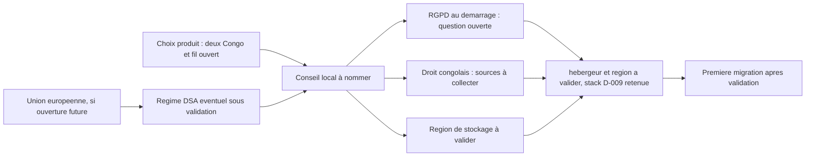

# Périmètre juridique

**Source primaire.** [Règlement (UE) 2022/2065, DSA, article 2](https://eur-lex.europa.eu/eli/reg/2022/2065/oj), [Règlement (UE) 2016/679, RGPD, article 3](https://eur-lex.europa.eu/eli/reg/2016/679/oj), [EDPB 4/2019](https://www.edpb.europa.eu/sites/default/files/files/file1/edpb_guidelines_201904_dataprotection_by_design_and_by_default_v2.0_en.pdf).
**Propriétaire de validation.** à nommer. **Statut.** proposée, conseil local à nommer. **Date.** 25 novembre 2026.

## Condition de `adr-001-stack.md`

Tant que les trois catégories ci-dessous ne sont pas séparées et validées, aucun hébergeur ni région de stockage n'est retenu. La stack est retenue en D-009 et décrite dans `../Technique/adr-001-stack.md`, mais la première migration est différée.

## Choix produit

Ce sont des décisions de Pro, pas des obligations juridiques.

- Deux marchés de départ : République du Congo (Brazzaville) et RDC (Kinshasa), traités séparément.
- Fil public sans compte, visiteur non connecté sans identifiant permanent.
- Événements conservés trente jours, notifications push réservées aux comptes, modération en deux temps, contestation par lien à usage unique.
- Aucune ouverture dans l'Union européenne dans le MVP.

## Texte cité

Les articles cités sont reproduits comme textes de référence. Aucune obligation actuelle pour les deux Congo n'en est déduite.

- DSA article 2 : le régime vise les services intermédiaires offerts à des destinataires dans l'Union. Le DSA est présenté ici comme un régime éventuel, sous validation, pas comme une obligation actuelle pour les deux Congo.
- DSA articles [16](https://www.eu-digital-services-act.com/Digital_Services_Act_Article_16.html), [17](https://www.springlex.eu/en/packages/dsa/dsa-regulation/article-17/) et [20](https://www.springlex.eu/en/packages/dsa/dsa-regulation/article-20/) : notification et action, exposé des motifs, traitement interne des plaintes. Ces articles ne sont pas présentés comme imposant une relecture préalable de chaque vidéo.
- RGPD article 3 : périmètre territorial du règlement. Le RGPD au démarrage dans les deux Congo est une question ouverte, pas un fait.
- EDPB 4/2019 : recommandations de minimisation et de pseudonymisation dès la conception. Ce n'est pas une loi congolaise.

## Points à valider par conseil local

| Point à valider | Pays | Question posée | Statut |
|---|---|---|---|
| Établissement et droit applicable | République du Congo, RDC | Quel texte s'applique à une plateforme locale de vidéo et de chat ? | à nommer |
| RGPD au démarrage | République du Congo, RDC | Le RGPD s'applique-t-il dès le démarrage ? | question ouverte |
| Protection des données personnelles | Brazzaville, Kinshasa | Quelles bases, registres et durées exiger ? | à nommer |
| Région de stockage | République du Congo, RDC | Une localisation particulière est-elle requise ? | à nommer |
| Qualification DSA | Union européenne, si ouverture future | Service d'hébergement ou plateforme en ligne ? | à trancher par conseil |

## Règle de mise à jour

Toute confirmation de source est datée et reliée à son pays. Tant qu'une ligne reste « à nommer », la fiche ne produit aucune affirmation d'obligation locale.
