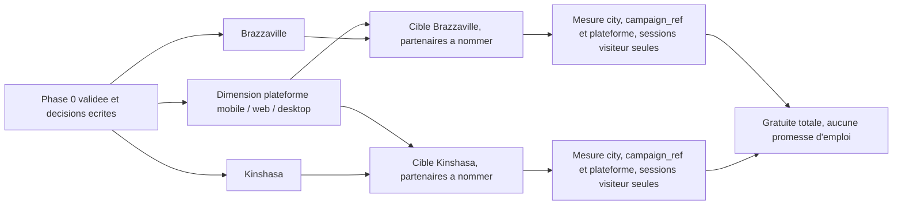

# Croissance : acquisition par ville

**Métier.** Acquisition, partenariats, animation de métiers et mesure de campagne.  
**Déclencheur.** Campagnes préparées avant ouverture, mesure disponible avant le premier lien.  
**Dépendances.** [PRD](../Product/prd.md), [Dictionnaire de mesures](../Product/mesure.md), [Décisions produit](../Product/decisions.md), [Recherche UX](../UX/ux-research.md), [Technique](../Technique/README.md), [Conformité](../Conformite/README.md).  
**Propriétaire.** Référent croissance, à nommer. Un référent par ville, à nommer.  
**Statut.** Fiches écrites, cibles chiffrées posées comme hypothèses de planification, partenaires et validateurs à nommer. Seuil de fil non vide tranché par A-10 : aucun seuil, repli immédiat vers le fil général de la ville concernée. Recrutement déclenché par les critères de sortie selon A-05, sans date de lancement inventée.

**Règle.** Gratuité totale pendant l’acquisition : Pro est gratuit à 100 %. Aucune promesse d’emploi, de salaire, de vérification N2 au MVP, de classement payant ou d’offre d’emploi au MVP. Brazzaville et Kinshasa ont des cibles, des partenaires et des mesures distincts. Aucune extrapolation d’une ville vers l’autre ni vers le continent. La dimension `plateforme` est lue avec la ville : `mobile` pour les applications natives iOS et Android, `web` pour le navigateur, `desktop` pour l’application exécutable Windows et macOS, rapide, sans lenteur. Linux est différé. Les messages et les liens couvrent les trois clients et restent sans promesse d’emploi. Aucune décision de gratuité n’est modifiée.

| Document | Ville | Question traitée | Déclencheur | Propriétaire |
|---|---|---|---|---|
| [acquisition-brazzaville.md](./acquisition-brazzaville.md) | Brazzaville | Cible et partenaires propres à Brazzaville | Avant ouverture du MVP | Référent ville, à nommer |
| [acquisition-kinshasa.md](./acquisition-kinshasa.md) | Kinshasa | Cible et partenaires propres à Kinshasa | Avant ouverture du MVP | Référent ville, à nommer |
| [lanceurs-metiers.md](./lanceurs-metiers.md) | Brazzaville, Kinshasa | Métiers pilotes, cible vérifiée, engagement de publication | Avant le fil public | Référent croissance, à nommer |
| [partenariats.md](./partenariats.md) | Brazzaville, Kinshasa | Circuit de validation des partenaires locaux | Après la recherche UX | Référent partenariats, à nommer |
| [phrases-invitation.md](./phrases-invitation.md) | Brazzaville, Kinshasa | Phrases autorisées, liste fermée, validation écrite | Avant la première campagne | Référent ville, à nommer |
| [mesure-campagnes.md](./mesure-campagnes.md) | Brazzaville, Kinshasa | Événements, champs, dénominateurs séparés | Avant le premier lien de campagne | Référent mesure, à nommer |
| [extension-afrique.md](./extension-afrique.md) | Hors deux villes | Conditions d’un marché suivant sans extrapolation | Après la phase 1 | Référent produit, à nommer |
| [Fiche de contrôle des phrases et campagnes](../../research_notes/Planning/controle-phrases-campagnes.md) | Brazzaville, Kinshasa | Points à vérifier et preuves à archiver, sans campagne ni phrase retenue | Avant la première campagne | À renseigner |

## Première action

Confirmer par écrit les trois métiers pilotes de chaque ville avec la personne qui mène la recherche UX, puis faire valider une phrase d’invitation par ville dans [phrases-invitation.md](./phrases-invitation.md).
