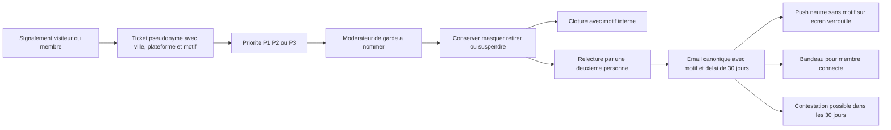

# Journée type de la modération

**Déclencheur.** Avant tout lien public, comme condition 6 de la section 11 du [PRD](../Product/prd.md).  
**Dépendances.** [astreinte](./astreinte.md), [manuel de modération](./moderation-manuel.md), [Dictionnaire de mesures](../Product/mesure.md), [Conformité](../Conformite/README.md).  
**Propriétaire.** Coordinateur des opérations, à nommer. Modérateur de garde par ville, à nommer.  
**Statut.** Hypothèses de dimensionnement écrites avant ouverture, à confirmer après sept jours de mesure. Modèle de renfort coopté et encadré retenu en A-09.

**Unité de volume.** Signalements attendus pour 1 000 sessions de fil, par ville et par motif. Ce sont des hypothèses de capacité, pas des résultats de terrain et pas une extrapolation d’une ville vers l’autre.

**Périmètre des plateformes.** Les volumes et la matrice valent pour les trois clients de la dimension `plateforme` : `mobile` pour les applications natives iOS et Android, `web` pour le navigateur, `desktop` pour l'application exécutable Windows et macOS, rapide, sans lenteur. Linux est différé. Les signalements sont lus par ville et par plateforme, sans fusion entre les deux villes ni entre plateformes.

| Ville | Spam | Contenu trompeur | Harcèlement | Contenu dangereux | Autre | Total pour 1 000 sessions |
|---|---:|---:|---:|---:|---:|---:|
| Brazzaville | 4 | 3 | 2 | 1 | 1 | 11 |
| Kinshasa | 5 | 4 | 2 | 1 | 1 | 13 |

## Matrice de priorité

| Priorité | Motif déclencheur | Délai de prise en charge | Temps cible par ticket | Relecture |
|---|---|---|---|---|
| P1 | Contenu dangereux, harcèlement dès le premier signalement, demande d’argent ou de codes dans le chat | 15 minutes, 24 h/24 par l’astreinte | Décision en 1 heure | Obligatoire avant retrait ou suspension |
| P2 | Contenu trompeur ou spam à partir de deux signalements | 2 heures | Décision en 8 heures ouvrées | Obligatoire avant retrait |
| P3 | Autre, signalement isolé sans urgence | 1 jour ouvré | Décision en 2 jours ouvrés | Relecture hebdomadaire par échantillon |

Effectif minimal par ville avant ouverture : 1 modérateur de garde et 1 relecteur joignable, tous deux à nommer. Le renfort est bénévole, coopté par le référent ville et encadré selon A-09.

## Deux signaux actionnables

| Signal | Source | Seuil d’alerte | Destinataire | Délai d’escalade |
|---|---|---|---|---|
| Profondeur de file | `queue_depth` | Plus de 20 tickets ouverts sur une ville pendant 15 minutes | Coordinateur des opérations, à nommer | Référent produit, à nommer, après 30 minutes sans reprise |
| Âge p95 d’un signalement | `report_age` | p95 supérieur à 4 heures sur une fenêtre glissante d’une heure | Coordinateur des opérations, à nommer | Référent produit, à nommer, après 30 minutes |

## Contrôle de sortie

Un exercice à blanc doit parcourir ce flux pour chaque ville et pour chaque plateforme (`mobile`, `web`, `desktop`), du signalement visiteur jusqu’à la notification d’auteur, avec validation du délai P1. Le compte rendu est écrit dans le canal unique de l’astreinte avant tout lien public.
