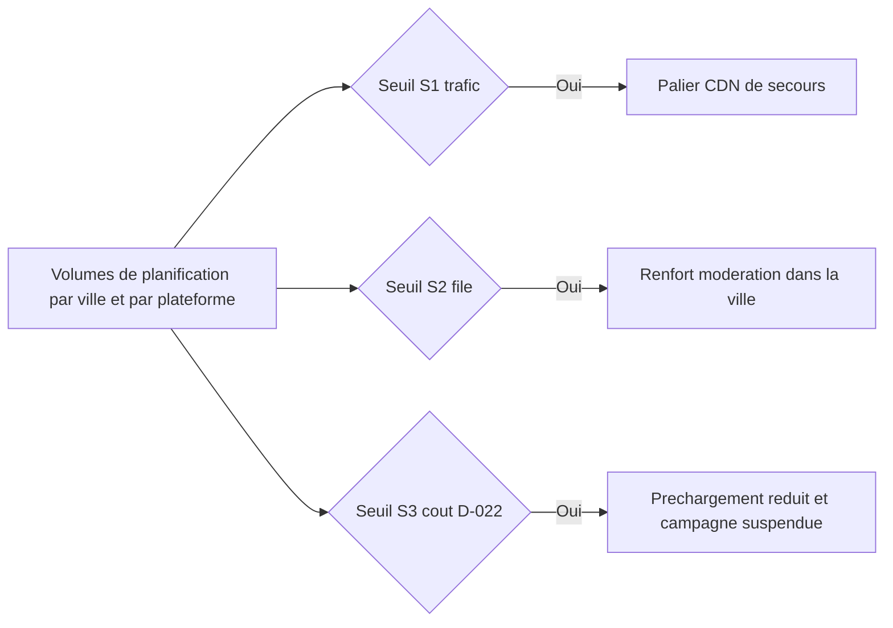

# Montée en charge

**Déclencheur.** Avant ouverture publique, avec le budget CDN inscrit en D-022.  
**Dépendances.** [Décisions produit](../Product/decisions.md), [Dictionnaire de mesures](../Product/mesure.md), [PRD](../Product/prd.md), [Technique](../Technique/README.md), [journée type](./journee-type-moderation.md).  
**Propriétaire.** Référent technique, à nommer. Coordinateur des opérations, à nommer, pour le seuil de file.  
**Statut.** Courbes de planification distinctes, seuils actionnables, budget CDN inscrit en D-022, capacité de modération à confirmer.

**Périmètre des plateformes.** Les courbes et les seuils couvrent les trois clients de la dimension `plateforme` : `mobile` pour les applications natives iOS et Android, `web` pour le navigateur, `desktop` pour l'application exécutable Windows et macOS, rapide, sans lenteur. Linux est différé. Aucun chiffre propre à une plateforme n'est inventé.

## Courbes par ville

Les valeurs sont des hypothèses de planification écrites avant ouverture, pas des mesures. Les deux courbes sont indépendantes : aucune valeur de Kinshasa n’est déduite de Brazzaville.

| Ville | Jour | Sessions de fil | Signalements attendus | Base de calcul |
|---|---|---:|---:|---|
| Brazzaville | J1 | 1 000 | 11 | 11 signalements pour 1 000 sessions |
| Brazzaville | J7 | 2 500 | 28 | même hypothèse propre à Brazzaville |
| Brazzaville | J14 | 4 000 | 44 | même hypothèse propre à Brazzaville |
| Kinshasa | J1 | 1 300 | 17 | 13 signalements pour 1 000 sessions |
| Kinshasa | J7 | 3 000 | 39 | même hypothèse propre à Kinshasa |
| Kinshasa | J14 | 5 000 | 65 | même hypothèse propre à Kinshasa |

## Seuils de bascule

| Seuil | Ville | Déclencheur mesuré | Action | Propriétaire | Délai |
|---|---|---|---|---|---|
| S1 trafic | Brazzaville puis Kinshasa, séparément | `video_impression` supérieur à 20 000 par jour sur une ville | Activer le palier CDN de secours et la qualité réduite | Référent technique, à nommer | 15 minutes |
| S2 file | Brazzaville puis Kinshasa, séparément | `queue_depth` supérieur à 20 ou p95 de `report_age` supérieur à 4 heures | Passer à 2 modérateurs et 1 relecteur pour la ville concernée | Coordinateur des opérations, à nommer | 30 minutes |
| S3 coût | Brazzaville puis Kinshasa, séparément | Coût par vue supérieur à 0,001 USD dans la ville, selon D-022 | Réduire le préchargement, forcer le transcodage adaptatif, suspendre la nouvelle campagne dans la ville | Référent technique, à nommer | 1 heure |

Le seuil S1 est lu par ville et par plateforme quand les données le permettent : le trafic `web` et le trafic `desktop` sont distingués dans la mesure, sans inventer de seuil propre à chacun. Quand les données ne permettent pas cette distinction, la lecture reste agrégée par ville et elle est signalée comme telle. Le seuil S3 s'applique aussi au client `desktop`, sans modifier l'arbitrage D-022.

Le budget CDN est fixé par [D-022](../Product/decisions.md) : 1 000 USD par mois, 500 USD par ville, fenêtre de mois civil et seuil de 0,001 USD par vue. La décision est révisée après 30 jours d'exploitation. Le [modèle de révision](../../research_notes/Planning/revision-D022-apres-30-jours.md) prépare cette écriture, sans date ni résultat préremplis. Le fournisseur n'est pas choisi dans cette fiche et aucun montant n'est présenté comme mesuré.

## Capacité de modération

Avant ouverture, chaque ville dispose de 1 modérateur de garde et de 1 relecteur joignable, à nommer. Le seuil S2 ajoute 1 modérateur dans la seule ville concernée. La couverture est de 08:00 à 20:00 en heure locale, avec astreinte P1 hors plage, selon A-09 et [astreinte.md](./astreinte.md). Le renfort est bénévole, coopté par le référent ville et encadré selon A-09, sans changer les chiffres de capacité ci-dessus.
