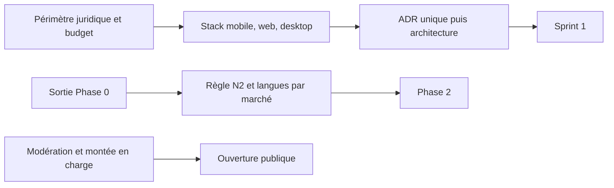

# Pro : grille d'arbitrage

**Statut** : version 3, 25 novembre 2026  
**Règle** : ce document prépare les choix, il ne les prend pas. Aucune option ci-dessous n'est retenue. Un arbitrage devient opposable seulement après inscription dans [decisions.md](./decisions.md) avec date, motif, propriétaire, source liée, portée et historique.  
**Documents liés** : [Registre des décisions](./decisions.md), [ADR stack](../Technique/adr-001-stack.md), [Performance](../Technique/performance.md), [Mesure](./mesure.md), [Roadmap](./roadmap.md), [Contestation](../Operations/contestation.md), [Lanceurs de métiers](../Growth/lanceurs-metiers.md), [Périmètre juridique](../Conformite/perimetre-juridique.md), [Responsabilités](../Technique/responsabilites.md).

Les décisions retenues D-001 à D-009, D-012 à D-021, D-023 et D-024 sont opposables. Les questions ouvertes D-010, D-011 et D-022 restent hors sprint jusqu'à leur inscription au registre. Le point A-01 est arbitré et renvoie à D-009. Le point A-13 précise la portée mobile de D-024 sans rouvrir cette décision. Toute réouverture suit la procédure écrite à la fin de `decisions.md`.

## Mode d'emploi

1. Choisir une option par ligne, ou écrire une option nouvelle avec son motif.
2. Inscrire le choix dans `decisions.md` avec date, motif, propriétaire, source liée, portée et historique.
3. Mettre à jour les documents touchés indiqués dans le tableau.
4. Si le choix modifie le périmètre `mobile`, `web` ou `desktop`, appliquer la règle de la section 2 du PRD avant toute autre modification.
5. Tant qu'une ligne n'est pas passée en décision retenue, elle n'entre dans aucun sprint.
6. Les références A-01 à A-13 sont classées par échéance, pas par ordre numérique. Le point A-13 concerne le sprint 1 et figure dans la première table.

## 1. Arbitrage avant le premier sprint

| Réf. | À arbitrer | Options ouvertes | Ce qu'il faut écrire | Documents touchés | Responsable | Échéance |
|---|---|---|---|---|---|---|
| A-01 | D-009 : stack `mobile`, `web` et `desktop`, arbitrée le 25 novembre 2026, voir D-009 | Clôturée. Option retenue : tout TypeScript, détaillée dans `../Technique/adr-001-stack.md` | Option retenue, versions LTS, familles de langages ou cadres, hébergeur après D-022, propriétaire, date. Outils inscrits dans l'ADR unique. | `adr-001-stack.md`, `architecture.md`, `video.md`, `performance.md`, `roadmap.md` | Équipe produit et technique, titulaire à nommer | Atteinte le 25 novembre 2026 |
| A-02 | D-022 : budget CDN et modération | 1. Budget par vue et par ville. 2. Enveloppe mensuelle avec plafond par ville. 3. Budget provisoire arrêté après la Phase 0. | Montant, devise, fenêtre, règle de seuil par vue, propriétaire. Le coût n'est pas présenté comme déjà couvert. | `video.md`, `montee-en-charge.md`, `mesure.md`, `roadmap.md` | à nommer | avant le gel de `video.md` |
| A-03 | D-023 : cibles numériques du client `desktop` | 1. Confirmer les cinq cibles proposées. 2. Les réviser après benchmark sur machine de référence. 3. Distinguer Windows et macOS. | Machine de référence, valeurs retenues, méthode de mesure, date de revue. Aucune valeur n'est présentée comme mesurée. | `prd.md` section 9, `performance.md`, `mesure.md`, définition de terminé | à nommer | avant le sprint 1 |
| A-04 | Équipe et effectif | 1. Confirmation de l'effectif écrit dans le PRD. 2. Équipe réduite avec prestataire pour le client `desktop`. 3. Effectif réévalué après arbitrage du budget. | Rôles, nombre, propriétaire du recrutement, conséquence sur les phases. | `prd.md`, `roadmap.md`, `decisions.md` | à nommer | avant le planning |
| A-05 | Date de lancement et calendrier | 1. Jalons par critères, sans date fixe. 2. Date fixe après arbitrages. 3. Fenêtre conditionnée à la sortie de la Phase 0. | Date ou règle de date, propriétaire, conséquence sur le recrutement et l'astreinte. | `roadmap.md`, `acquisition-brazzaville.md`, `acquisition-kinshasa.md`, `astreinte.md` | à nommer | avant le planning |
| A-13 | Portée mobile de D-024, mise à jour sans cycle de store | 1. Règles, contenus et éléments d'interface autorisés servis côté serveur seulement. 2. Ajout de bundles légers autorisés par les règles des stores. 3. Aucun élément modifiable hors binaire natif sur mobile. | Liste fermée de ce qui est modifiable hors binaire, règle par store, date de validation, propriétaire, conduite à tenir si la règle change. Aucune règle de store n'est affirmée sans preuve écrite. | `prd.md` section 10.1, `adr-001-stack.md`, `securite.md`, `confidentialite-visiteur.md`, définition de terminé | à nommer | avant le sprint 1 |

## 2. Arbitrage avant la Phase 2

| Réf. | À arbitrer | Options ouvertes | Ce qu'il faut écrire | Documents touchés | Responsable | Échéance |
|---|---|---|---|---|---|---|
| A-06 | D-010 : règle N2 pour les candidatures | 1. Vérification obligatoire pour toutes les candidatures. 2. Vérification seulement à la demande de l'employeur. 3. Vérification obligatoire pour les offres signalées. | Règle retenue, preuve acceptée, réversibilité du badge, événement dédié si nécessaire. | `prd.md` section 14, `verification-identite.md`, `userstories.md` US-16, `mesure.md` | à nommer | avant l'ouverture des offres |
| A-07 | D-011 : nom et privilèges du niveau organisations payant | 1. Nom neutre avec statistiques avancées. 2. Nom lié à l'organisation avec offres signalées hors recherche. 3. Privilèges d'administration supplémentaires. | Nom, liste fermée de privilèges, phase d'entrée. D-019 interdit tout classement payant dans la recherche. | `roadmap.md` phase 5, `manifeste.md`, `prd.md` section 14.5, `decisions.md` | à nommer | avant la conception de la phase 5 |
| A-08 | Langues après le français | 1. Aucune autre langue avant la Phase 3. 2. Une langue par marché après recherche locale. 3. Anglais après validation d'un marché. | Langue, marché, date, responsable. Toute nouvelle langue est inscrite au registre selon D-008. | `vision.md`, `prd.md`, `manifeste.md`, `decisions.md`, `ux-research.md` | à nommer | avant l'extension hors des deux Congo |

## 3. Arbitrage avant ouverture publique

| Réf. | À arbitrer | Options ouvertes | Ce qu'il faut écrire | Documents touchés | Responsable | Échéance |
|---|---|---|---|---|---|---|
| A-09 | Modèle de modération | 1. Bénévole. 2. Salarié. 3. Mixte avec noyau salarié et renfort bénévole. | Modèle retenu, couverture horaire, propriétaire, lien avec D-022. | `Operations/README.md`, `astreinte.md`, `montee-en-charge.md`, `decisions.md` | à nommer | avant tout lien public |
| A-10 | Seuil de fil non vide | 1. Seuil par métier et par ville. 2. Seuil global par ville. 3. Aucun seuil et repli immédiat vers le fil général. | Nombre, ville, métier, propriétaire, règle de repli. Le seuil n'est pas transposé d'une ville à l'autre. | `lanceurs-metiers.md`, `mesure.md`, `acquisition-brazzaville.md`, `acquisition-kinshasa.md` | à nommer | avant ouverture |
| A-11 | Niveau OWASP ASVS visé | 1. Niveau 1. 2. Niveau 2. 3. Niveau 3. | Niveau retenu, portée d'application, propriétaire de la revue. | `securite.md`, `responsabilites.md`, définition de terminé | à nommer | avant la revue de sortie MVP |
| A-12 | Qualification juridique et périmètre RGPD | 1. RGPD applicable dès les deux Congo, sous avis écrit. 2. RGPD non applicable au démarrage, sous avis écrit. 3. Qualification DSA différée à une ouverture européenne. | Avis du conseil local, pays concernés, date, propriétaire. Ce document ne tranche aucune obligation. | `perimetre-juridique.md`, `union-europeenne.md`, `confidentialite-visiteur.md`, `adr-001-stack.md` | conseil local, à nommer | avant le choix de l'hébergeur, la région de stockage et la première migration |

## 4. À nommer sans arbitrage de principe

Ces champs sont des titulaires à désigner, pas des options à départager. Ils doivent être remplis avant les jalons indiqués.

| Champ | Document | Jalons |
|---|---|---|
| Titulaire de la stack et de l'architecture | `responsabilites.md`, `adr-001-stack.md` | avant le sprint 1 |
| Validateur des hypothèses H1 à H8 | `ux-research.md`, `roadmap.md` | avant la Phase 0 |
| Référent produit et référent technique par ville | `Operations/README.md`, `Growth/README.md` | avant ouverture |
| Coordinateur de garde et relecteur par ville | `astreinte.md`, `contestation.md` | avant tout lien public |
| Propriétaire des mesures et des alertes | `mesure.md`, `tableau-de-bord.md` | avant instrumentation de FS-11 |
| Responsable d'extension par marché | `extension-afrique.md`, `decisions.md` | avant la Phase 3 |

## 5. Après un arbitrage

Une ligne arbitrée change de statut. Elle quitte cette grille pour entrer dans la table des décisions retenues de `decisions.md`. La ligne d'origine reçoit une mention du type « arbitrée le date, voir D-025 ». Le numéro de décision est attribué dans l'ordre, sans saut.

Aucun arbitrage ne modifie en silence une décision déjà retenue. Si un choix contredit une décision retenue (D-001 à D-009, D-012 à D-021, D-023 et D-024), la procédure de réouverture de `decisions.md` s'applique avec la nouvelle preuve, la date, la décision remplacée et la liste des documents touchés. Une question ouverte suit la grille, puis l'inscription au registre, sans passer par la réouverture. Le point A-13 est une précision de portée de D-024, pas une réouverture.
