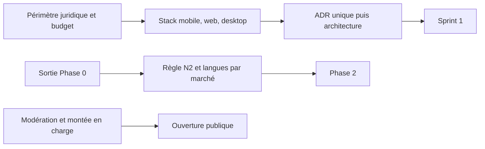

# Pro : grille d'arbitrage

**Statut** : version 3, 25 novembre 2026  
**Règle** : ce document prépare les choix, il ne les prend pas. Une option arbitrée porte sa date et son numéro de décision, sinon aucune option ci-dessous n'est retenue. Un arbitrage devient opposable seulement après inscription dans [decisions.md](./decisions.md) avec date, motif, propriétaire, source liée, portée et historique.  
**Documents liés** : [Registre des décisions](./decisions.md), [ADR stack](../Technique/adr-001-stack.md), [Performance](../Technique/performance.md), [Mesure](./mesure.md), [Roadmap](./roadmap.md), [Contestation](../Operations/contestation.md), [Lanceurs de métiers](../Growth/lanceurs-metiers.md), [Périmètre juridique](../Conformite/perimetre-juridique.md), [Responsabilités](../Technique/responsabilites.md).

Les décisions retenues D-001 à D-024 sont opposables, y compris D-010, D-011 et D-022 inscrites le 26 novembre 2026. Aucune question ouverte ne reste au registre. Les points A-01, A-02, A-06, A-07 et A-11 sont arbitrés et renvoient aux décisions ou aux fiches techniques concernées. Le point A-13 précise la portée mobile de D-024 sans rouvrir cette décision. Toute réouverture suit la procédure écrite à la fin de `decisions.md`.

## Mode d'emploi

1. Choisir une option par ligne, ou écrire une option nouvelle avec son motif.
2. Inscrire le choix dans `decisions.md` avec date, motif, propriétaire, source liée, portée et historique.
3. Mettre à jour les documents touchés indiqués dans le tableau.
4. Si le choix modifie le périmètre `mobile`, `web` ou `desktop`, appliquer la règle de la section 2 du PRD avant toute autre modification.
5. Tant qu'une ligne n'est pas passée en décision retenue, elle n'entre dans aucun sprint.
6. Les références A-01 à A-13 sont classées par échéance, pas par ordre numérique. Le point A-13 concerne le sprint 1 et figure dans la première table.

## 1. Arbitrage avant le premier sprint

| Réf. | À arbitrer | Options ouvertes | Ce qu'il faut écrire | Documents touchés | Responsable | Échéance |
|---|---|---|---|---|---|---|
| A-01 | D-009 : stack `mobile`, `web` et `desktop`, arbitrée le 25 novembre 2026, voir D-009 | Clôturée. Option retenue : tout TypeScript, détaillée dans `../Technique/adr-001-stack.md` | Option retenue, versions LTS, familles de langages ou cadres, hébergeur après A-12, fournisseur CDN dans le cadre de D-022, propriétaire, date. Outils inscrits dans l'ADR unique. | `adr-001-stack.md`, `architecture.md`, `video.md`, `performance.md`, `roadmap.md` | Équipe produit et technique, titulaire à nommer | Atteinte le 25 novembre 2026 |
| A-02 | D-022 : budget CDN et modération | Arbitrée le 26 novembre 2026 : enveloppe mensuelle de 1 000 USD, 500 USD par ville, mois civil, seuil de 0,001 USD par vue. | Montant, devise, fenêtre, seuil et révision après 30 jours sont inscrits en D-022. Le fournisseur CDN n'est pas choisi par cet arbitrage. | `video.md`, `montee-en-charge.md`, `mesure.md`, `roadmap.md` | Espoir LOEMBA, intérimaire | Atteinte le 26 novembre 2026 |
| A-03 | D-023 : cibles numériques du client `desktop` | Décision intérimaire du porteur, 25 novembre 2026 : option 1, les cinq cibles proposées sont retenues comme cibles. | Machine de référence, méthode de mesure et date de revue restent à confirmer. Aucune valeur n'est présentée comme mesurée. | `prd.md` section 9, `performance.md`, `mesure.md`, définition de terminé | Espoir LOEMBA, intérimaire | avant le sprint 1 |
| A-04 | Équipe et effectif | Décision intérimaire du porteur, 25 novembre 2026 : porteur unique appuyé par les outils IA, prestataires à nommer pour le client `desktop`. | L'effectif du PRD reste une référence, pas un engagement. Rôles, prestataires et conséquence sur les phases restent à écrire. | `prd.md`, `roadmap.md`, `decisions.md` | Espoir LOEMBA, intérimaire | avant le planning |
| A-05 | Date de lancement et calendrier | Décision intérimaire du porteur, 25 novembre 2026 : option 1, jalons par critères sans date fixe. | Aucune date de lancement n'est inventée. La conséquence sur le recrutement et l'astreinte reste à écrire. | `roadmap.md`, `acquisition-brazzaville.md`, `acquisition-kinshasa.md`, `astreinte.md` | Espoir LOEMBA, intérimaire | avant le planning |
| A-13 | Portée mobile de D-024, mise à jour sans cycle de store | Décision intérimaire du porteur, 25 novembre 2026 : option 1, éléments servis côté serveur seulement. | Liste fermée et règle par store restent à prouver par écrit. Conduite à tenir si la règle change reste à écrire. | `prd.md` section 10.1, `adr-001-stack.md`, `securite.md`, `confidentialite-visiteur.md`, définition de terminé | Espoir LOEMBA, intérimaire | avant le sprint 1 |

## 2. Arbitrage avant la Phase 2

| Réf. | À arbitrer | Options ouvertes | Ce qu'il faut écrire | Documents touchés | Responsable | Échéance |
|---|---|---|---|---|---|---|
| A-06 | D-010 : règle N2 pour les candidatures | Arbitrée le 26 novembre 2026 : vérification seulement à la demande de l'employeur, voir D-010. | Règle, preuve acceptée, réversibilité du badge et événement dédié sont inscrits en D-010. | `prd.md` section 14, `verification-identite.md`, `userstories.md` US-16, `mesure.md` | Espoir LOEMBA, intérimaire | Atteinte le 26 novembre 2026 |
| A-07 | D-011 : nom et privilèges du niveau organisations payant | Arbitrée le 26 novembre 2026 : `Organisation Avancée`, avec statistiques avancées, voir D-011. | Nom, liste fermée des privilèges et phase d'entrée sont inscrits en D-011. D-019 interdit tout classement payant dans la recherche. | `roadmap.md` phase 5, `manifeste.md`, `prd.md` section 14.5, `decisions.md` | Espoir LOEMBA, intérimaire | Atteinte le 26 novembre 2026 |
| A-08 | Langues après le français | Décision intérimaire du porteur, 25 novembre 2026 : option 1, aucune autre langue avant la Phase 3. | Toute nouvelle langue est inscrite au registre selon D-008. | `vision.md`, `prd.md`, `manifeste.md`, `decisions.md`, `ux-research.md` | Espoir LOEMBA, intérimaire | avant l'extension hors des deux Congo |

## 3. Arbitrage avant ouverture publique

| Réf. | À arbitrer | Options ouvertes | Ce qu'il faut écrire | Documents touchés | Responsable | Échéance |
|---|---|---|---|---|---|---|
| A-09 | Modèle de modération | Décision intérimaire du porteur, 25 novembre 2026 : option 3 retenue dans son principe, modèle mixte. | Noyau, renfort bénévole et couverture horaire restent à nommer. Lien avec D-022 écrit dans `montee-en-charge.md` par l'enveloppe par ville et le coût par vue. | `Operations/README.md`, `astreinte.md`, `montee-en-charge.md`, `decisions.md` | Espoir LOEMBA, intérimaire | avant tout lien public |
| A-10 | Seuil de fil non vide | Décision intérimaire du porteur, 25 novembre 2026 : option 3, aucun seuil et repli immédiat vers le fil général. | Aucun seuil n'est transposé d'une ville à l'autre. Règle de repli à confirmer par ville. | `lanceurs-metiers.md`, `mesure.md`, `acquisition-brazzaville.md`, `acquisition-kinshasa.md` | Espoir LOEMBA, intérimaire | avant ouverture |
| A-11 | Niveau OWASP ASVS visé | Arbitrée le 26 novembre 2026 : niveau 2, sur le backend et les trois clients livrés ensemble. | Niveau, portée et propriétaire de la revue sont inscrits dans `securite.md` et `responsabilites.md`. | `securite.md`, `responsabilites.md`, définition de terminé | Espoir LOEMBA, intérimaire | Atteinte le 26 novembre 2026 |
| A-12 | Qualification juridique et périmètre RGPD | En attente d'avis externe. Aucune obligation n'est tranchée dans ce document. | Avis du conseil local, pays concernés et date restent à nommer. | `perimetre-juridique.md`, `union-europeenne.md`, `confidentialite-visiteur.md`, `adr-001-stack.md` | conseil local, à nommer | avant le choix de l'hébergeur, la région de stockage et la première migration |

## 4. À nommer sans arbitrage de principe

Ces champs sont des titulaires à désigner, pas des options à départager. Le porteur unique les cumule de manière intérimaire depuis le 25 novembre 2026, sauf l'avis juridique local qui reste externe. Toute délégation future est écrite puis assignée explicitement.

| Champ | Document | Jalons | Titulaire intérimaire |
|---|---|---|---|
| Titulaire de la stack et de l'architecture | `responsabilites.md`, `adr-001-stack.md` | avant le sprint 1 | Espoir LOEMBA |
| Validateur des hypothèses H1 à H8 | `ux-research.md`, `roadmap.md` | avant la Phase 0 | Espoir LOEMBA |
| Référent produit et référent technique par ville | `Operations/README.md`, `Growth/README.md` | avant ouverture | Espoir LOEMBA |
| Coordinateur de garde et relecteur par ville | `astreinte.md`, `contestation.md` | avant tout lien public | Espoir LOEMBA |
| Propriétaire des mesures et des alertes | `mesure.md`, `tableau-de-bord.md` | avant instrumentation de FS-11 | Espoir LOEMBA |
| Responsable d'extension par marché | `extension-afrique.md`, `decisions.md` | avant la Phase 3 | Espoir LOEMBA |
| Avis juridique local | `perimetre-juridique.md`, `confidentialite-visiteur.md` | avant le choix de l'hébergeur et de la région de stockage | conseil local, à nommer |

## 5. Après un arbitrage

Une ligne arbitrée change de statut. Elle quitte cette grille pour entrer dans la table des décisions retenues de `decisions.md`. La ligne d'origine reçoit une mention du type « arbitrée le date, voir le numéro attribué dans `decisions.md` ». Le numéro de décision est attribué dans l'ordre, sans saut.

Aucun arbitrage ne modifie en silence une décision déjà retenue. Si un choix contredit une décision retenue (D-001 à D-009, D-012 à D-021, D-023 et D-024), la procédure de réouverture de `decisions.md` s'applique avec la nouvelle preuve, la date, la décision remplacée et la liste des documents touchés. Une question ouverte suit la grille, puis l'inscription au registre, sans passer par la réouverture. Le point A-13 est une précision de portée de D-024, pas une réouverture.
