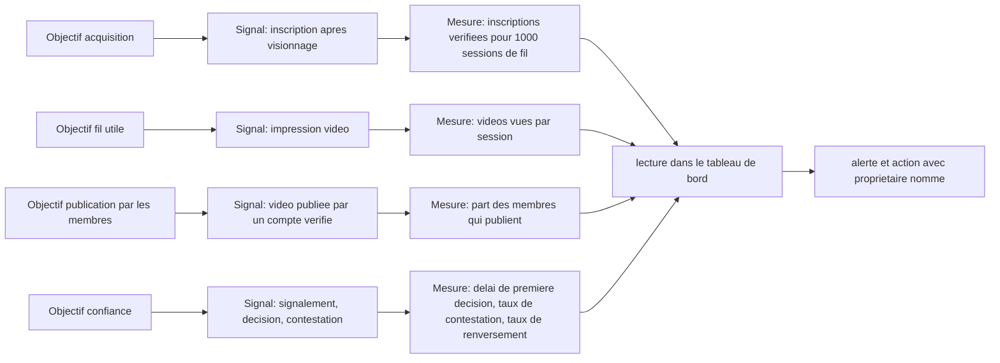

# Pro : dictionnaire canonique des mesures

**Statut** : version 1, 25 novembre 2026  
**Rôle** : source unique des noms, formules, dénominateurs et garde-fous. Toute autre formulation dans la [vision](./vision.md), le [manifeste](./manifeste.md) ou le [PRD](./prd.md) renvoie à ce fichier.  
**Documents liés** : [Décisions](./decisions.md), [Expérimentation](./experimentation.md), [Tableau de bord](./tableau-de-bord.md), [Observation](../Technique/README.md)

Aucune cible chiffrée n'est inventée dans ce cadrage. Chaque cible est nommée après la sortie de la Phase 0, puis inscrite au registre avec sa date et son propriétaire. Le [modèle de décision des cibles KPI](../../research_notes/Planning/decision-cibles-KPI.md) prépare cette écriture, sans chiffre prérempli. Les garde-fous relatives sont définies à partir d'une base relevée pendant la Phase 0 ou les deux premières semaines d'observation, puis journalisées au registre.

## Règles communes

**Plateformes.** La dimension `plateforme` prend les valeurs `mobile`, `web` et `desktop`, définies ainsi :

- `mobile` : applications natives iOS et Android sur téléphone.
- `web` : site responsive dans un navigateur, utilisé sur ordinateur et tablette.
- `desktop` : application exécutable installée sur Windows et macOS. Linux est différé et non spécifié en phase 1.

- Événements canoniques autorisés : `app_open`, `feed_session_start`, `video_impression`, `video_complete`, `guest_save_attempt`, `signup_start`, `signup_verified`, `push_opt_in`, `video_publish_attempt`, `video_published`, `message_sent`, `report_created`, `report_resolved`, `moderation_action`, `appeal_opened`, `appeal_resolved`, `queue_depth`, `report_age`.
- Chaque événement porte `plateforme` avec une valeur parmi `mobile`, `web` et `desktop`. Il peut porter `city`, `trade` et `campaign_ref`. Ces quatre dimensions de lecture restent séparées et ne sont jamais des identifiants permanents.
- Aucune mesure ne fusionne les plateformes sans le dire : une lecture par plateforme porte la valeur `mobile`, `web` ou `desktop`, et une lecture agrégée est nommée explicitement « toutes plateformes » dans le nom de la tuile et dans la population.
- Conservation des événements : 30 jours. Les agrégats ont une finalité et une durée inscrites au registre avant la première mesure. Le [modèle de décision](../../research_notes/Sprint-1/decision-conservation-agregats.md) prépare cette écriture, sans durée ni finalité préremplies.
- Aucun identifiant d'appareil permanent, aucun traceur tiers, aucune correspondance entre appareils.
- D-020 : La mesure à sept jours porte sur les comptes ayant un email vérifié. Aucune cohorte visiteur à sept jours n'est calculée, puisqu'aucun identifiant permanent visiteur n'est conservé.
- Les dénominateurs ne sont pas fusionnés : une mesure par session de fil reste distincte d'une mesure par compte vérifié.
- Le nom canonique d'acquisition est inscriptions avec email vérifié pour 1 000 sessions de fil, calculé par `signup_verified / feed_session_start * 1000`.
- A-10 : aucun seuil de fil non vide n'est défini. Quand un `trade` n'a pas de vidéo modérée dans une ville, le fil général de cette ville est servi immédiatement, sans transposition vers l'autre ville. Le repli est écrit avec la ville, la date et le propriétaire. Aucun événement ni dénominateur supplémentaire n'est créé ; les cibles de semis restent des hypothèses de planification.

## Chemin objectif, signal, mesure

## Mesures d'acquisition et d'engagement

| Nom canonique | Formule | Dénominateur | Événement source | Population | Période | Cible | Garde-fou | Propriétaire | Cadence de revue |
|---|---|---|---|---|---|---|---|---|---|
| Inscriptions avec email vérifié pour 1 000 sessions de fil | `signup_verified / feed_session_start * 1000` | `feed_session_start` | `feed_session_start`, `signup_verified` | Sessions de fil sur `mobile`, `web` et `desktop`, puis comptes dont l'email est vérifié ; lecture par `plateforme` ou agrégat nommé « toutes plateformes » | 30 jours glissants | à nommer après la Phase 0 | Ne pas compter comme vérification une vérification d'identité ou d'organisation ; `signup_verified` désigne l'email en phase 1 | Équipe produit, responsable à nommer | Hebdomadaire |
| Vidéos vues par session | `count(video_impression) / count(feed_session_start)` | `feed_session_start` | `video_impression`, `feed_session_start` | Sessions de fil sur `mobile`, `web` et `desktop`, visiteurs et membres confondus sans identifiant permanent, cette fusion de populations étant explicite ; lecture par `plateforme` ou agrégat nommé « toutes plateformes » | 30 jours glissants | à nommer après la Phase 0 | Ne pas substituer `video_complete` à `video_impression` ; le taux de complétion est lu séparément | Équipe produit, responsable à nommer | Hebdomadaire |
| Part des membres qui publient | `count(distinct compte avec video_published) / count(distinct compte avec signup_verified)` | Comptes avec email vérifié | `video_published`, `signup_verified` | Comptes dont l'email a été vérifié sur `mobile`, `web` et `desktop` ; lecture par `plateforme` ou agrégat nommé « toutes plateformes » | 30 jours glissants | à nommer après la Phase 0 | Ne pas utiliser les comptes non vérifiés ni les sessions comme dénominateur | Équipe produit, responsable à nommer | Hebdomadaire |
| Retour à sept jours des comptes vérifiés | `count(compte vérifié avec app_open ou feed_session_start au 7e jour) / count(compte vérifié dans la cohorte)` | Comptes vérifiés de la cohorte | `signup_verified`, `app_open`, `feed_session_start` | Comptes dont l'email a été vérifié sur `mobile`, `web` et `desktop`, aucun visiteur ; lecture par `plateforme` ou agrégat nommé « toutes plateformes » | Cohorte de 30 jours glissants, observation au 7e jour | à nommer après la Phase 0 | Aucune cohorte visiteur, aucun identifiant permanent visiteur, selon D-020 | Équipe produit, responsable à nommer | Hebdomadaire |

## Mesures de confiance et de modération

| Nom canonique | Formule | Dénominateur | Événement source | Population | Période | Cible | Garde-fou | Propriétaire | Cadence de revue |
|---|---|---|---|---|---|---|---|---|---|
| Délai de première décision de modération | p50 et p95 de `horodatage(premier moderation_action) - horodatage(report_created)` pour un même signalement | Signalements ayant reçu une première décision | `report_created`, `moderation_action` | Signalements créés par un visiteur ou un membre sur `mobile`, `web` et `desktop`, toutes villes ; lecture par `plateforme` ou agrégat nommé « toutes plateformes » | 30 jours glissants | à nommer après la Phase 0 | Aucun signalement sans décision au delà du délai retenu ; alerte vers l'astreinte décrite dans `../Operations/README.md` | Équipe modération, responsable à nommer | Quotidienne |
| Taux de contestation | `count(appeal_opened) / count(report_resolved) * 100` | Signalements résolus avec notification d'auteur | `appeal_opened`, `report_resolved` | Signalements résolus dont l'auteur a été notifié, sur `mobile`, `web` et `desktop` ; lecture par `plateforme` ou agrégat nommé « toutes plateformes » | 30 jours glissants | à nommer après la Phase 0 | Ne pas confondre une contestation avec un nouveau signalement ; l'empreinte du jeton est stockée dans `appeal` | Équipe modération, responsable à nommer | Hebdomadaire |
| Taux de renversement | `count(appeal_resolved avec décision modifiée) / count(appeal_opened) * 100` | Contestations ouvertes | `appeal_opened`, `appeal_resolved` | Contestations enregistrées dans la table `appeal`, sur `mobile`, `web` et `desktop` ; lecture par `plateforme` ou agrégat nommé « toutes plateformes » | 30 jours glissants | à nommer après la Phase 0 | Toute décision modifiée porte un motif et l'utilisateur qui a statué ; aucune modification silencieuse | Équipe modération, responsable à nommer | Hebdomadaire |

## Utilisation

Le [tableau de bord](./tableau-de-bord.md) affiche ces mesures telles quelles, avec la dimension `plateforme` et les dimensions `city`, `trade` et `campaign_ref` distinctes, ainsi que les règles d'alerte. La [fiche d'expérimentation](./experimentation.md) les emploie comme métrique primaire ou comme garde-fous sans redéfinir leur formule. La roadmap subordonne le premier sprint à la publication de ce dictionnaire, conformément à la séquence de remédiation.
