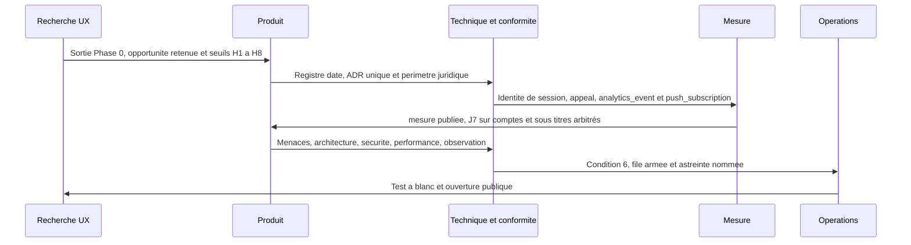

# Pro : roadmap produit

**Statut** : version 4, 26 novembre 2026  
**Documents liés** : [Vision](./vision.md), [PRD](./prd.md), [Décisions](./decisions.md), [Mesure](./mesure.md), [Définition de terminé, section 11 du PRD](./prd.md)

Une phase se termine quand ses critères de sortie sont vrais et que les preuves sont archivées. Les phases ne sont pas définies par des durées : aucune date de lancement n'est arrêtée dans ce cadrage, selon A-05 arbitrée le 26 novembre 2026. La date de lancement est à nommer avant le planning. Le [modèle de décision](../../research_notes/Planning/decision-date-lancement.md) prépare cette écriture sans date préremplie et sans déclencher de planning. La revue de sortie associe quatre fonctions : produit, design, développement et modération, avec un responsable nommé par phase. Le [modèle de compte rendu](../../research_notes/Planning/revue-sortie-phase.md) prépare cette revue sans responsable ni date préremplis. Le porteur unique est intérimaire selon A-04 ; l'effectif du PRD reste une référence de planification, pas un engagement.

## Phase 0 : recherche fondatrice

**Objectif.** Découvrir ce qui fait qu'un visiteur croit une vidéo, accepte de s'identifier et ose envoyer un message.

**Livrables.** Cycle de dix jours ouvrés prévu dans la recherche UX, huit entretiens à Brazzaville et Kinshasa, personas corrigés, arbre d'opportunités à jour, preuves archivées.

**Seuils H1 à H8 et validateurs.** Les seuils et conditions d'infirmation ci-dessous sont repris du registre d'hypothèses de `UX/ux-research.md`. Chaque résultat est confirmé ou infirmé par le validateur nommé, puis inscrit au compte rendu de J10. Le [modèle de nomination](../../research_notes/Cycle-1/hypotheses/nomination-validateurs.md) prépare ces huit désignations avant J1, sans nom prérempli ni hypothèse validée par avance.

| Hypothèse | Condition d'infirmation | Condition de confirmation | Validateur nommé |
|---|---|---|---|
| H1 | Moins de 5 personnes sur 8 savent nommer un métier ou une personne utile après trois vidéos | Au moins 5 personnes sur 8 savent le nommer | Responsable produit, à nommer avant J1 |
| H2 | La majorité des 8 sessions choisit le badge et demande une preuve hors vidéo | La majorité choisit la vidéo sans demander de preuve hors vidéo | Responsable produit et design, à nommer avant J1 |
| H3 | Les gens rangent spontanément « résultat obtenu » ou « outil maîtrisé » avant le lieu chez la majorité des 8 participants | Métier et ville restent les premiers critères cités | Responsable design, à nommer avant J1 |
| H4 | Plus de 7 personnes sur 10 abandonnent à l'étape email | 7 personnes sur 10 au plus abandonnent | Responsable produit et design, à nommer avant J1 |
| H5 | 6 personnes sur 8 demandent une preuve d'identité avant de répondre | Moins de 6 personnes sur 8 la demandent | Responsable produit, à nommer avant J1 |
| H6 | 4 créateurs sur 5 disent publier sans y penser | Moins de 4 créateurs sur 5 le disent | Responsable produit, à nommer avant J1 |
| H7 | 3 participants sur 5 demandent plus de temps ou renoncent | Moins de 3 participants sur 5 le demandent ou renoncent | Responsable design, à nommer avant J1 |
| H8 | 0 différence observée entre les deux groupes sur les questions RQ2 et RQ3 | Au moins une différence documentée entre les deux groupes sur RQ2 ou RQ3 | Responsable produit et modération, à nommer avant J1 |

Le dénominateur de H4 est celui du registre UX, soit 10, alors que le plan de terrain prévoit 6 participants à J8. Le validateur nomme le dénominateur retenu avant J8 et écrit ce choix dans le registre des décisions. Les conditions d'infirmation qualitatives de H2, H3 et H8 sont appliquées telles quelles et leur conversion en seuil numérique est tranchée par le validateur avant le test concerné.

**Critères de sortie.** Chaque hypothèse H1 à H8 est confirmée ou infirmée selon les seuils ci-dessus. Les hypothèses infirmées sont nommées avec leur preuve. Une seule opportunité O1 à O5 est retenue par écrit, avec son identifiant, dans le compte rendu de J10. Aucune hypothèse n'est reportée au-delà du premier sprint sans décision écrite au registre, avec responsable et date. Aucune histoire FS-01 à FS-11 n'entre dans ce sprint sans identifiant O ou H. La [check-list de clôture](../../research_notes/Cycle-1/checklist-cloture-phase0.md) prépare la vérification de ces critères, sans case cochée à l'avance.

**Dépendance.** Recrutement possible dans les deux villes, déclenché par les critères de sortie et non par une date de lancement, selon A-05. Le terrain du cycle 1 se déroule en français, selon A-08.

## Phase 1 : MVP dans les deux Congo

**Objectif.** Livrer le fil public, les profils, la publication, le chat 1:1, la recherche et la modération de base, sur les trois clients livrés ensemble.

**Plateformes.** La dimension `plateforme` prend les valeurs `mobile`, `web` et `desktop`, définies ainsi :

- `mobile` : applications natives iOS et Android sur téléphone.
- `web` : site responsive dans un navigateur, utilisé sur ordinateur et tablette.
- `desktop` : application exécutable installée sur Windows et macOS. Linux est différé et non spécifié en phase 1.

**Périmètre.** Spécifications FS-01 à FS-11 du PRD. Les clients `mobile`, `web` et `desktop` livrés ensemble, conformément à D-004, avec le client desktop exécutable Windows et macOS de D-023. Taxonomie métier et ville calibrée sur Brazzaville et Kinshasa, selon D-017. Vérification limitée à l'email vérifié, selon D-018. Sous-titres des vidéos avec son selon D-021.

**Dépendances.** Dépendance explicite à la sortie de la Phase 0 : opportunité retenue par écrit, seuils H1 à H8 tranchés, validateur nommé et preuves archivées. Stack retenue en D-009 et détaillée dans `../Technique/adr-001-stack.md`, service vidéo, service d'emails, file de modération assumée, dictionnaire de mesures publié dans `./mesure.md`. Porteur unique et intérimaire selon A-04, prestataires du client `desktop` à nommer avant le premier commit de code de stack. Jalons par critères de sortie selon A-05, sans date de lancement fixée. Cinq cibles de revue du client desktop arbitrées le 26 novembre 2026 par A-03 (D-023 et PRD, section 9.1), avec revue de performance prévue le 26 décembre 2026 et profil R2 décrit dans `../Technique/performance.md`. Le [dossier de préparation du sprint 1](../../research_notes/Sprint-1/README.md) rend les tâches, les contrats et les contrôles lisibles avant le premier commit, sans écrire de code applicatif.

**Critères de sortie.** Les sept conditions de la section 11 du PRD sont réunies, avec les critères d’acceptation de chaque FS validés sur `mobile`, `web` et `desktop`. Les trois clients sont livrés ensemble : `mobile`, `web` et `desktop`. Aucun client desktop n'est repoussé après le MVP ; Linux reste différé et non spécifié en phase 1. La trace des revues de cas d'erreur, de revue de code et de revue d'accessibilité est archivée avec l'identifiant du relecteur et la date. Les événements canoniques sont émis et le tableau de bord décrit dans `./tableau-de-bord.md` affiche les mesures du dictionnaire, ventilées par `plateforme` avec les valeurs `mobile`, `web` et `desktop`. La condition 6 de la section 11 du PRD est vérifiée : file de modération armée, astreinte nominée et test à blanc du signalement visiteur jusqu'à la notification d'auteur. La condition 7 est vérifiée : mise à jour automatique éprouvée sur les trois clients, avec signature, retour arrière et non interruption de session, selon la section 10.1 du PRD et la liste fermée de six catégories arbitrée en A-13 le 26 novembre 2026. Le seuil de coût par vue est fixé à 0,001 USD par vue par D-022, avec une enveloppe de 1 000 USD par mois lue séparément par ville. Le fil public applique A-10 : aucun seuil de fil non vide, repli immédiat vers le fil général de la ville concernée si un métier n'a pas de vidéo modérée, sans transposition d'une ville à l'autre.

## Phase 2 : emploi et pages d'organisation gratuites

**Objectif.** Ouvrir les offres et les pages d'organisation sans introduire de privilège payant.

**Périmètre.** Section 14 du PRD. Une organisation vérifiée possède une page principale et autant de pages rattachées que nécessaire. Les rôles sont propres à chaque page.

**Critères de sortie.** N3 organisation vérifiable par domaine ou document légal, avec propriétaire de la vérification et révocation documentée. Pour le profil N2, la méthode et la réversibilité du badge sont écrites dans D-010, retenue le 26 novembre 2026, hors MVP. Invitations acceptées, journal d'audit complet, offres visibles sur toutes les pages, aucune fonction réservée à un abonnement.

**Dépendances.** D-010 retenue pour N2, capacité de vérification organisationnelle, modération des offres, procédure de contestation dans `../Operations/README.md`.

## Phase 3 : extension au reste de l'Afrique

**Objectif.** Répliquer le produit dans un ou plusieurs autres pays africains sans présumer que les usages congolais s'y transposent.

**Livrables.** Nouveau cycle UX par marché, taxonomie métier et ville étendue, langues validées marché par marché avec date, responsable et marché inscrits au registre avant le premier contenu dans cette langue selon D-008 et A-08, mesure du coût vidéo par réseau.

**Critères de sortie.** Au moins un second cycle de recherche terminé hors des deux Congo, aucune généralisation non documentée, seuil de coût par vidéo vue de 0,001 USD inscrit en D-022, puis mesuré par marché.

**Dépendances.** Données de la Phase 1, partenariats locaux décrits dans `../Growth/README.md`, décision budgétaire D-022 inscrite le 26 novembre 2026, hébergement et CDN adaptés décrits dans `../Technique/README.md`.

## Phase 4 : ouverture au reste du monde, gratuite

**Objectif.** Ouvrir le réseau au-delà de l'Afrique sans introduire de niveau payant.

**Périmètre.** Accès public gratuit sur tous les marchés ouverts. Aucun niveau payant, aucune offre signalée dans la recherche. Les éventuelles offres signalées restent hors recherche et relèvent de la Phase 5.

**Critères de sortie.** Gratuité de l'accès public conservée, aucun identifiant permanent ajouté pour le visiteur, aucun classement payant dans la recherche, langues ajoutées uniquement avec date, responsable et marché inscrits au registre avant le premier contenu dans cette langue, conformément à D-008 et A-08.

**Dépendances.** Questions de marché propres à la Phase 4 tranchées et datées, D-010 si sa règle N2 n'a pas été appliquée en Phase 2, conformité des nouveaux marchés décrite dans `../Conformite/README.md`.

## Phase 5 : monétisation organisations

**Objectif.** Introduire un niveau organisations payant distinct du réseau Pro.

**Périmètre.** Le nom et les privilèges de ce niveau sont définis par D-011, retenue le 26 novembre 2026 : `Organisation Avancée`, statistiques agrégées, export mensuel et alertes définies par l'organisation. Aucun classement payant dans la recherche, y compris dans cette phase. Les offres signalées éventuelles restent hors recherche.

**Critères de sortie.** Décision D-011 retenue depuis le 26 novembre 2026 avec date, motif, propriétaire, nom et privilèges écrits au registre ; gratuité de l'accès public inchangée ; aucun identifiant permanent visiteur ajouté.

**Dépendances.** D-011 retenue, modèle économique documenté, mesure du coût par vue issue de la Phase 3, validation du cadre applicable par marché dans `../Conformite/README.md`.

## Séquence de remédiation avant ouverture

L'ordre est imposé par les dépendances : la recherche commande le sprint, le registre commande l'ADR, l'identité commande les événements, la mesure commande l'instrumentation, la modération commande l'ouverture.

Chaque étape a un critère de sortie vérifiable : opportunité écrite et seuils chiffrés, douze lignes du registre renseignées et questions ouvertes séparées, table `appeal` complète et identité de session décidée, mesure canonique et sous-titres tranchés, architecture précédée des menaces, puis test à blanc réussi. Les deux dernières étapes conditionnent tout lien public, comme décrit dans `../Operations/README.md`.
