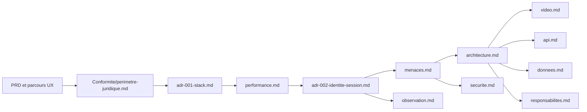

# Technique : architecture, décisions et contrôles

**Métier.** Ingénierie `mobile`, `web`, `desktop`, backend et données.
**Statut.** Socle rédigé le 25 novembre 2026, à valider. La stack est retenue en D-009 et détaillée dans `adr-001-stack.md`.
**Règle.** Le PRD ne choisit pas la stack. `adr-001-stack.md` couvre les trois clients livrés ensemble, `mobile`, `web` et `desktop`, et le backend. L'hébergeur, la région de stockage et le fournisseur vidéo restent liés à A-12 et D-022.
**Modèle ADR unique.** Titre, Statut, Contexte, Options, Décision, Conséquences, Propriétaire, Date. Statuts admis : retenue, proposée, à trancher.
**Accessibilité.** WCAG 2.2 niveau AA visé. Cibles de 24 sur 24 pixels CSS au minimum AA, objectif de 44 pixels au-delà du minimum. Contraste AA vérifié : 4,5:1 pour le texte courant, 3:1 pour les grands textes et les composants. Sources : [SC 1.4.3](https://www.w3.org/TR/WCAG22/#contrast-minimum) et [SC 2.5.8](https://www.w3.org/WAI/WCAG22/Understanding/target-size-minimum.html).

## Dépendances des ADR et des fiches

Le client desktop est couvert par `adr-001-stack.md` pour les axes de stack, par `performance.md` pour le profil R2, par `architecture.md` pour le conteneur `client_desktop` et par `responsabilites.md` pour la revue de performance. Ces dépendances ne créent aucun ADR numéroté supplémentaire : `adr-001-stack.md` suffit pour les trois clients.

La mise à jour automatique est une contrainte transversale de D-024, décrite dans la section 10.1 du [PRD](../Product/prd.md) et contrôlée dans `securite.md`. Elle ne crée pas d'ADR numéroté supplémentaire. La part du `mobile` modifiable hors binaire natif est précisée au point A-13 de `../Product/arbitrage.md` avant le sprint 1.

| Fiche | Question traitée | Déclencheur | Dépendances | Propriétaire | Statut |
|---|---|---|---|---|---|
| [adr-001-stack.md](adr-001-stack.md) | Stack retenue `mobile`, `web`, `desktop` et backend, D-009 | Arbitrage A-01 atteint le 25 novembre 2026 | Décision D-009, note `../../memoires/2026-11-25-stack-typescript.md` | Équipe produit et technique, titulaire à nommer | retenue |
| [performance.md](performance.md) | Budgets de latence, bande passante, profil R1 et profil R2 desktop, valeurs à confirmer | Avant `architecture.md` et `video.md` | PRD section 10 | à nommer | proposée, valeurs à confirmer |
| [adr-002-identite-session.md](adr-002-identite-session.md) | Jeton visiteur court, clé par finalité, rotation, liaison à `signup_verified` | Avant FS-01 et la première migration | `performance.md`, `../Product/mesure.md` | à nommer | retenue sur les principes |
| [menaces.md](menaces.md) | Quatre questions OWASP et six menaces priorisées | Avant `securite.md` et `architecture.md` | `adr-002-identite-session.md` | à nommer | proposée |
| [architecture.md](architecture.md) | C4 conteneur, lecture séparée de l'écriture, invalidation de cache | Après `adr-001`, avant `video.md` et `api.md` | `menaces.md`, `performance.md` | à nommer | proposée |
| [video.md](video.md) | Octets, bitrates, coût pour 1 000 vues, EXIF | Avant FS-02 | `architecture.md`, arbitrage D-022 | à nommer | proposée, budget ouvert |
| [api.md](api.md) | Endpoints, réponses sans données privées, limites | Avant FS-04 et FS-08 | `architecture.md`, `adr-002-identite-session.md` | à nommer | proposée |
| [donnees.md](donnees.md) | Tables, états, transitions et traduction de la conservation | Avant la première migration | `../Conformite/conservation.md`, `adr-002-identite-session.md` | à nommer | proposée |
| [securite.md](securite.md) | Socle de contrôles, jetons, journal d'audit | Avant FS-01 et FS-02, revue avant FS-07 et FS-09 | `menaces.md`, `adr-002-identite-session.md` | à nommer | proposée |
| [observation.md](observation.md) | Événements canoniques, schéma, tableau de bord et alertes | Avant l'implémentation de FS-11 | `../Product/mesure.md`, `adr-002-identite-session.md` | à nommer | proposée |
| [responsabilites.md](responsabilites.md) | RACI des ADR, confidentialité, escalade, signature et budget | Avant la revue de sortie MVP | Toutes les fiches ci-dessus | à nommer | proposée |

## Liens de cadrage

[PRD](../Product/prd.md), [dictionnaire de mesures](../Product/mesure.md), [registre des décisions](../Product/decisions.md), [parcours UX](../UX/userflow.md), [Opérations](../Operations/README.md).

## Première action

Nommer le propriétaire de `adr-001-stack.md`, puis obtenir la validation juridique A-12 et le budget D-022. Les familles de technologie sont retenues en D-009. Tant qu'A-12, D-022 et A-13 ne sont pas écrits, aucun hébergeur, région de stockage, fournisseur CDN ni périmètre mobile hors binaire natif n'est arrêté, et aucun code n'est écrit.
