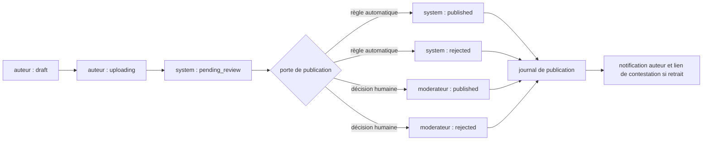

# ADR 003 : porte de publication

Décision retenue sur les acteurs et le journal de publication des vidéos.

## Titre

Acteurs de la publication et journal des transitions de vidéo.

## Statut

retenue

## Contexte

Le parcours B du PRD parle de « validation automatique » et la vision impose l'état `pending_review` avant publication. Le journal d'audit exige un identifiant d'acteur, y compris quand personne n'a cliqué. Sans règle, une décision automatique est journalisée sans acteur, ou un identifiant de modérateur est inventé.

## Options

| Acteur | Quand il est utilisé | Ce qu'il ne fait pas |
|---|---|---|
| `system` | Règle déterministe exécutée par la plateforme, avec identifiant de règle | Ne simule pas un modérateur humain |
| `moderateur` | Décision humaine sur un ticket | N'écrit pas de motif vide |
| `auteur` | Dépôt d'une vidéo en `draft` puis `uploading` | Ne publie pas directement en `published` |

## Décision

Les trois acteurs `system`, `moderateur` et `auteur` sont les seules valeurs autorisées sur une transition de vidéo. Toute transition est écrite dans le journal de publication, en ajout seul, avec : identifiant de la vidéo, état source, état cible, acteur, identifiant de règle si l'acteur est `system`, motif, horodatage, référence de signalement si elle existe. Le champ `rule_id` vaut `aucun` pour un acteur humain. Une décision automatique n'est pas silencieuse : elle porte `system` et un `rule_id` existant.

« Validation automatique » signifie une décision `system` journalisée, pas une publication sans contrôle. Un retrait passe par `removed`, avec conservation selon `../Conformite/conservation.md` et ouverture possible d'une contestation dans `appeal`.

## Conséquences

- Aucune ligne de publication n'a un acteur `inconnu` ou un identifiant de modérateur fabriqué.
- `video_published` n'est émis qu'après l'écriture de la ligne de journal, selon `observation.md`.
- Le motif est un code fermé, sans donnée personnelle superflue dans le texte libre.
- Test de vérification : pour une vidéo publiée automatiquement, le journal contient `system` et un `rule_id` ; pour une vidéo rejetée par un modérateur, il contient `moderateur`, le motif et l'horodatage.

## Propriétaire

à nommer

## Date

25 novembre 2026
