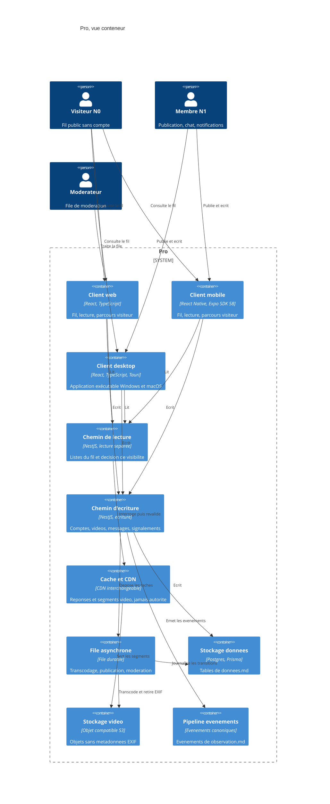

# Architecture : conteneurs, chemins et cache

**Propriétaire.** Espoir LOEMBA, intérimaire depuis le 25 novembre 2026 au titre de A-04. **Statut.** proposée. **Date.** 25 novembre 2026.
**Dépendances.** `adr-001-stack.md` avec D-009 retenue, `performance.md`, `menaces.md`.

## Diagramme C4, niveau conteneur

## Séparation des chemins

| Chemin | Responsabilité | Ce qu'il ne fait jamais |
|---|---|---|
| Lecture | Servir le fil, les profils publics et les segments vidéo ; appliquer la visibilité courante | Modifier l'état d'un objet ou décider d'une publication |
| Écriture | Valider, journaliser, persister et déposer les tâches asynchrones | Servir une réponse de fil depuis son propre cache |
| File asynchrone | Transcodage, publication, notification, modération | Autoriser une lecture directe |

Les listes de candidats du fil peuvent être précalculées. Elles ne sont jamais une décision d'accès.

## Invalidation de cache et contrôle vérifiable

Mécanisme retenu :

1. Toute écriture qui change la visibilité valide la transaction, puis émet `visibility_changed` avec identifiant de la vidéo, motif, acteur et horodatage.
2. Le cache reçoit l'événement et purge la clé de la vidéo. Une durée de vie courte de 30 secondes est proposée, à confirmer, comme filet de sécurité.
3. Avant chaque réponse, le chemin de lecture appelle `decision_visibilite(video_id, niveau, region, blocage, signalement)` sur l'état courant. Un refus l'emporte toujours sur un hit de cache.
4. Le refus est journalisé avec l'identifiant de la règle, conformément à `adr-003-porte-publication.md`.
5. Un compteur de revalidation est exposé au pipeline d'observation, sans identifiant visiteur.

**Contrôle C1.** « Un cache n'est pas une autorisation » signifie : aucune réponse ne quitte le chemin de lecture sans appel à `decision_visibilite`. La règle vaut aussi pour le client desktop : un cache local sur Windows ou macOS ne décide jamais de la visibilité. Le contrôle est vérifiable par le compteur et par le test ci-dessous.

**Test de non régression T1.** Publier une vidéo, réchauffer le cache, puis la faire retirer par un modérateur. Dans les deux secondes suivantes, rejouer l'URL mise en cache : la réponse doit être 404, le compteur de revalidation doit augmenter et une ligne `moderation_action` avec `acteur = moderateur` doit être présente. Le test est rejoué après expiration du TTL et depuis les trois clients, y compris le client desktop.

## Budgets appliqués

Les seuils de `performance.md` sont la grille de revue, y compris le profil R2 pour le client desktop. Le transcodage et les octets servis sont décrits dans `video.md`.
