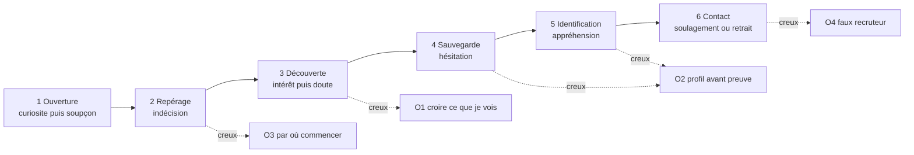
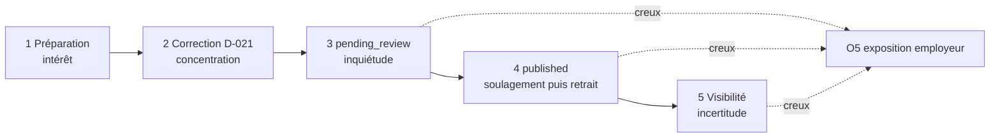

# Pro : carte de parcours

**Statut** : version 1, 25 novembre 2026  
**Nature** : carte d'hypothèses. Aucune observation de participant n'a encore eu lieu. Les émotions ci-dessous sont à confirmer au cycle 1.  
**Documents liés** : [Parcours](./userflow.md), [Recherche UX](./ux-research.md), [Principes de design](./design-principles.md), [PRD](../Product/prd.md)

Une carte de parcours montre ce que la personne traverse, et non ce que l'équipe souhaite qu'elle fasse. Le chemin nominal est décrit dans [userflow.md](./userflow.md) ; il n'est pas recopié ici.

## Carte 1 : trouver un professionnel et l'écrire

**Acteur.** Amina, profil fictif de chercheuse d'emploi à Brazzaville, décrit dans [personas.md](./personas.md).

**Scénario.** Elle a trois vidéos à regarder avec un forfait limité. Elle veut savoir si une personne fait vraiment le métier annoncé, puis lui écrire sans donner un profil complet.

**Plateformes des phases.** Les phases 1 à 6 du tableau sont décrites pour application mobile, site web ou application desktop. Aucune phase n'est attribuée à une plateforme par avance, et les émotions ne sont pas supposées identiques d'une plateforme à l'autre.

| Phase | Action dans le parcours A | Pensée hypothétique | Courbe émotionnelle | Creux et opportunité |
|---|---|---|---|---|
| 1. Ouverture | Le fil s'affiche sans compte | « Je croyais qu'on allait me demander un compte » | Curiosité, puis soupçon | Creux léger à l'ouverture : O2, H1 |
| 2. Repérage | Métier et ville choisis ou passés | « Est-ce que ça change vraiment ce que je vois ? » | Indécision | Creux : O3, H3 |
| 3. Découverte | Trois vidéos regardées | « Est-ce que cette personne fait vraiment ce métier ? » | Intérêt, puis doute | Creux : O1, H1 et H2 |
| 4. Sauvegarde | Geste sur une vidéo, phrase courte sur le compte | « Je veux la garder sans donner mes données » | Hésitation | Creux : O2, H4 |
| 5. Identification | Email et code vérifiés | « Si je donne mon email, que va-t-il se passer ? » | Appréhension | Creux : O2, H4 |
| 6. Contact | Message depuis une vidéo ou un profil | « Est-ce que l'autre voit bien qui je suis ? » | Soulagement ou retrait | Creux : O4, H5 et H9 |

**Lecture de la courbe.** Le point le plus bas se situe à l'identification : la personne doit donner son email au moment où elle a le moins de preuves sur l'usage qui en sera fait. Le deuxième point bas est le contact : l'identité affichée peut rassurer, mais les quatre signaux de R7 rendent le premier message risqué. Le creux du repérage est plus court : il dépend de la correspondance entre le métier choisi et le fil proposé.

| Creux | Opportunité | Hypothèse à confirmer | Preuve à récolter au cycle 1 |
|---|---|---|---|
| Soupçon à l'ouverture | O2 | H1 | Nommer un métier ou une personne après trois vidéos, sur 8 participants |
| Indécision au repérage | O3 | H3 | Tri de cartes, ordre des critères chez 8 participants |
| Doute sur la vidéo | O1 | H1, H2 | Geste de jugement codé avant l'opinion, puis note de 1 à 5 |
| Hésitation à sauvegarder | O2 | H4 | Abandon à l'étape email avec un seul dénominateur par variante |
| Appréhension à l'email | O2 | H4 | Code expiré, phrase d'explication, adresse de test |
| Peur au premier message | O4 | H5, H9 | Geste observé sur deux messages, dont un avec les signaux de R7 |

## Carte 2 : publier sans exposer son travail

**Acteur.** Serge, profil fictif de professionnel en poste à Kinshasa, décrit dans [personas.md](./personas.md).

**Scénario.** Il filme son travail le week-end et hésite à le montrer, craignant que son employeur le voie et que la vidéo paraisse moins sérieuse qu'un CV.

**Plateformes des phases.** Les phases 1 à 5 du tableau sont décrites pour application mobile, site web ou application desktop. La préparation, la correction et l'attente ne sont pas attribuées à un appareil par avance.

| Phase | Action | Pensée hypothétique | Courbe émotionnelle | Creux et opportunité |
|---|---|---|---|---|
| 1. Préparation | Sélection et compression | « Est-ce que ça suffit pour montrer mon travail ? » | Intérêt | Sans creux majeur |
| 2. Correction | Légende, mots-clés, sous-titres corrigés | « Si je ne corrige pas, je ne peux pas publier » | Concentration | Point de contrôle : D-021, O1 |
| 3. Attente | `pending_review` | « Qui va voir cette vidéo avant moi ? » | Inquiétude | Creux : O5, H6 |
| 4. Publication | `published`, profil et fil | « Est-ce que mon employeur va la voir ? » | Soulagement puis retrait | Creux : O5, H6 et H7 |
| 5. Décision | Masquer ville et bio | « Est-ce que ça suffit à ne pas être reconnu ? » | Incertitude | Creux : O5, H6 |

O5 est liée à H6 et H7, testées auprès des cinq créateurs réservés au plan de terrain. Si H6 est confirmée, la règle de visibilité employeur est écrite dans FS-05 et tranchée avec une date au registre. Tant que D-010 est ouverte, aucune fonction liée au recrutement n'est ajoutée à cette carte.

## Limites de la carte

Les deux cartes reposent sur des profils fictifs et sur les hypothèses H1 à H9. Elles ne mesurent ni la fréquence des creux ni leur intensité. Elles ne mesurent pas non plus les différences d'usage entre application mobile, site web et application desktop : le cycle 1 observe les trois plateformes sans présumer que les usages desktop soient identiques au mobile. Elles servent à choisir une opportunité par sprint, avec la règle de la section 12 de [ux-research.md](./ux-research.md).
