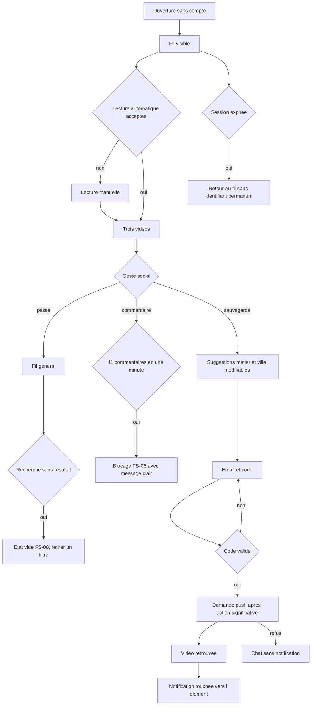
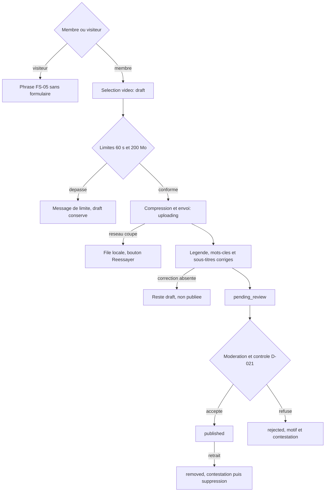
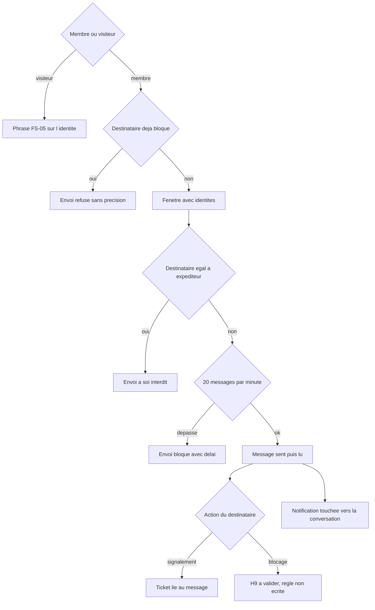
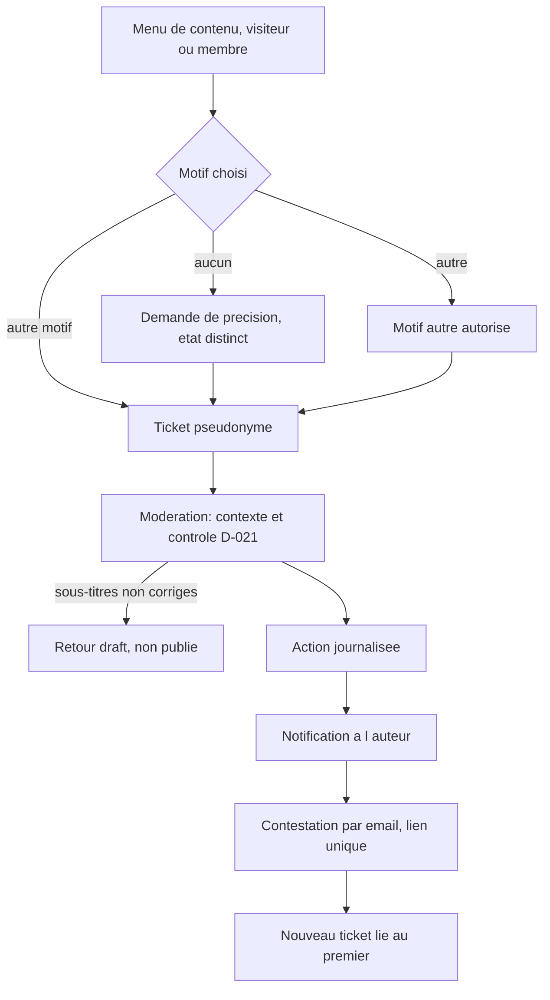

# Pro : parcours utilisateur

**Statut** : version 2, 25 novembre 2026  
**Documents liés** : [PRD](../Product/prd.md), [Décisions](../Product/decisions.md), [Mesure](../Product/mesure.md), [Recherche UX](./ux-research.md), [Carte de parcours](./journey-map.md), [Principes de design](./design-principles.md), [Grille de relecture](../Redaction/ia-defauts-et-tips.md)

Un parcours décrit un chemin et ses embranchements. Les critères d'acceptation détaillés restent dans le [PRD](../Product/prd.md). Ce fichier sert à placer les décisions, les états et les moments d'identification. Aucune règle nouvelle n'est créée ici : une règle absente du PRD est marquée comme hypothèse avec un identifiant H.

**Langues.** Français d'abord. Les langues suivantes sont validées marché par marché, avec date et responsable inscrits au registre. Aucune autre langue n'est datée dans ce cadrage.

**Plateformes.** La dimension `plateforme` prend les valeurs `mobile`, `web` et `desktop` définies dans la [recherche UX](./ux-research.md). Les quatre parcours sont décrits pour application mobile, site web ou application desktop.

**Accessibilité commune aux quatre parcours.** Le site web vise WCAG 2.2 niveau AA, avec des cibles d'au moins 24 sur 24 CSS px comme minimum et 44 pixels comme objectif au delà du minimum. L'application desktop suit les directives natives de Windows et macOS : WCAG n'est pas présenté comme une règle directe pour une application native. Chaque parcours précise ensuite le lecteur d'écran, l'ordre de focus, le contraste, le mouvement réduit et la taille de cible, avec une ligne propre au desktop.

## Parcours A : du visiteur au membre

**Entrée.** Ouverture sans compte.

**Plateformes.** Parcours décrit pour application mobile, site web ou application desktop.

1. Le fil s'affiche immédiatement, sans écran de connexion.
2. La personne choisit un métier et une ville, ou passe.
3. Elle regarde trois vidéos. La lecture automatique peut être refusée.
4. Elle touche « Sauvegarder ».
5. Une phrase courte explique qu'un compte permet de retrouver la vidéo. Les choix de métier et de ville de FS-03 sont proposés comme suggestions modifiables, jamais importés sans accord.
6. Elle saisit son email, puis un code vérifié.
7. La demande d'autorisation push est faite après cette première action significative, jamais au lancement. Le parcours continue si elle est refusée.
8. La vidéo sauvegardée réapparaît dans sa liste.

**Embranchements.**

- Refus de lecture automatique (FS-01) : la vidéo reste à l'arrêt avec un bouton de lecture manuel libellé ; aucun son ni mouvement n'est déclenché.
- Fin de session (FS-01) : retour au fil sans identifiant permanent côté serveur ; métier et ville de la session ne sont pas conservés au delà de la session.
- Filtres passés (FS-03) : fil général, sans suggestion importée dans le formulaire d'inscription.
- État vide de recherche (FS-08) : deux filtres actifs sans résultat, proposition de retirer un filtre, aucun écran de connexion.
- Onzième commentaire en une minute (FS-06) : envoi bloqué avec un message clair ; like et sauvegarde restent réversibles.
- Code expiré : nouveau code après un délai court, nombre de tentatives limité.
- Refus push (FS-10) : le chat reste accessible sans notification système.
- Notification touchée (FS-10) : ouverture directe de la vidéo, du profil ou de la conversation concernée, sans passer par le fil.

**Sortie.** Compte vérifié, vidéo retrouvée, droit de publier ouvert.

**Événements.** `app_open`, `feed_session_start`, `video_impression`, `video_complete`, `guest_save_attempt`, `signup_start`, `signup_verified`, `push_opt_in`.

**Accessibilité du parcours A sur le web.** Lecteur d'écran : chaque vidéo porte un libellé avec métier et ville, et le bouton de lecture manuelle est nommé. Ordre de focus : filtres, vidéo, sauvegarde, email, code, demande push, sans piège de focus. Contraste : textes et commandes vérifiés AA, y compris sur la phrase d'explication de l'email. Mouvement réduit : lecture automatique désactivée si la préférence système est posée. Taille de cible : filtres et actions au moins 24 sur 24 CSS px, objectif 44 px.

**Accessibilité desktop du parcours A.** API natives Windows et macOS pour le lecteur d'écran et les commandes ; ordre de focus clavier et souris du fil vers la demande push, sans piège ; contraste vérifié selon les directives natives ; mouvement réduit respecté pour la lecture automatique ; taille de cible des filtres et des actions conforme aux directives natives Windows et macOS.

## Parcours B : publication d'une vidéo

**Entrée.** Membre connecté, bouton « Publier ». Un visiteur qui touche ce bouton reçoit une phrase courte (FS-05), pas un formulaire complet.

**Plateformes.** Parcours décrit pour application mobile, site web ou application desktop.

1. La personne sélectionne une vidéo depuis son appareil, téléphone ou ordinateur. L'état est `draft`.
2. L'application vérifie la durée, la taille et le format avant tout envoi.
3. La vidéo est compressée sur l'appareil, puis l'envoi démarre. L'état est `uploading`.
4. Elle ajoute une légende et jusqu'à trois mots-clés.
5. Préparation des sous-titres, règle D-021 : « Les vidéos avec son du MVP disposent de sous-titres générés automatiquement et corrigés par l'auteur avant publication. Si la correction n'est pas faite, la vidéo reste en brouillon et n'est pas publiée. »
6. La vidéo passe à `pending_review` et entre dans la file de modération.
7. Étape de modération, règle D-021 : « Les vidéos avec son du MVP disposent de sous-titres générés automatiquement et corrigés par l'auteur avant publication. Si la correction n'est pas faite, la vidéo reste en brouillon et n'est pas publiée. » Le contrôle porte sur la présence des sous-titres corrigés avant toute mise en ligne.
8. Après validation, la vidéo passe à `published` et apparaît sur le profil et dans le fil du créateur.
9. Si la modération retire une vidéo publiée, l'état devient `removed` ; l'auteur reçoit une notification avec une voie de contestation. Un refus avant publication mène à `rejected`, avec motif et contestation.

**Embranchements.**

- Visiteur (FS-05) : phrase « un compte est nécessaire pour être identifiable », sans demande d'email déguisée en formulaire.
- Fichier de plus de 60 secondes ou 200 Mo : limite affichée avant l'envoi, l'état reste `draft`.
- Sous-titres non corrigés (D-021) : la vidéo reste en brouillon `draft`, aucun passage à `uploading` ni à `published`.
- Coupure réseau pendant `uploading` : la vidéo reste dans la file locale avec « Réessayer », sans resélectionner le fichier.
- Refus en modération : passage à `rejected`, motif affiché à l'auteur, contestation par email avec lien unique relié au ticket d'origine.
- Retrait après publication : passage à `removed`, visible ni sur le profil ni dans le fil, conservé le temps du délai de contestation puis supprimé.

**Sortie.** Vidéo `published`, `rejected`, `removed` ou en attente de contestation.

**Événements.** `video_publish_attempt`, `video_published`.

**Accessibilité du parcours B sur le web.** Lecteur d'écran : état de la vidéo annoncé avec son libellé (`draft`, `uploading`, `pending_review`, `published`, `rejected`) et progression d'envoi explicite. Ordre de focus : sélection, légende, sous-titres, correction, publication, sans perte de focus après « Réessayer ». Contraste : limite de taille, motif de refus et état de modération lisibles AA. Mouvement réduit : aperçu vidéo remplacé par une image fixe si la préférence est posée. Taille de cible : « Réessayer » et « Corriger les sous-titres » au moins 24 sur 24 CSS px, objectif 44 px.

**Accessibilité desktop du parcours B.** API natives Windows et macOS pour le lecteur d'écran et le sélecteur de fichier ; ordre de focus clavier et souris de la sélection à la publication, avec focus conservé après « Réessayer » ; contraste des limites et des motifs selon les directives natives ; mouvement réduit appliqué à l'aperçu ; taille de cible de « Réessayer » et de « Corriger les sous-titres » conforme aux directives natives Windows et macOS.

## Parcours C : contact entre deux membres

**Entrée.** Profil public ou vidéo ouverte par un membre. Un visiteur qui touche « Message » reçoit la phrase FS-05 sur l'identité nécessaire, sans formulaire complet.

**Plateformes.** Parcours décrit pour application mobile, site web ou application desktop.

1. La personne touche « Message ».
2. La fenêtre affiche l'identité de l'expéditeur et du destinataire.
3. Elle écrit un message de 2 000 caractères maximum.
4. Le message est envoyé, puis lu par le destinataire ; l'accusé de lecture s'affiche.
5. Le destinataire peut répondre, bloquer ou signaler.

**Embranchements.**

- Envoi à soi-même (FS-07) : bouton désactivé avec phrase explicite, aucun message créé.
- Plus de 20 messages en une minute (FS-07) : envoi bloqué avec message indiquant la limite et le délai d'attente.
- Destinataire bloqué avant l'ouverture (FS-07) : envoi refusé sans préciser qui a bloqué qui.
- Blocage après réception : **hypothèse H9**, pas une règle du PRD. La conversation resterait lisible et l'envoi suivant serait refusé. À valider au J4 à J6, puis à inscrire dans FS-07 seulement si la décision est écrite.
- Message signalé : ticket de modération créé avec l'identifiant du message.
- Notification touchée : ouverture directe de la conversation concernée.

**Sortie.** Message envoyé, lu, signalé ou bloqué.

**Événement.** `message_sent`.

**Accessibilité du parcours C sur le web.** Lecteur d'écran : identité de l'expéditeur et du destinataire annoncée à l'ouverture, et limite de 2 000 caractères annoncée avec le compteur restant. Ordre de focus : identité, champ de message, compteur, envoi, signaler, bloquer. Contraste : avertissement de demande suspecte et motif de refus vérifiés AA. Mouvement réduit : aucun effet d'envoi animé obligatoire, accusé de lecture textuel. Taille de cible : actions « Signaler » et « Bloquer » au moins 24 sur 24 CSS px, objectif 44 px.

**Accessibilité desktop du parcours C.** API natives Windows et macOS pour le lecteur d'écran et l'annonce du compteur ; ordre de focus clavier et souris de l'identité aux actions « Signaler » et « Bloquer » ; contraste de l'avertissement et du motif de refus selon les directives natives ; mouvement réduit avec accusé de lecture textuel ; taille de cible des actions conforme aux directives natives Windows et macOS.

## Parcours D : signalement et contestation

**Entrée.** Menu d'une vidéo, d'un message ou d'un profil. Le signalement est ouvert au visiteur avec une référence pseudonyme, sans identifiant permanent.

**Plateformes.** Parcours décrit pour application mobile, site web ou application desktop.

1. La personne choisit un motif : spam, contenu trompeur, harcèlement, contenu dangereux, autre. « Motif autre » est un motif autorisé ; « aucun motif sélectionné » est un état distinct qui demande une précision.
2. Un ticket est créé avec une référence pseudonyme du signalant.
3. Le modérateur ouvre la file et voit le contenu, le motif et l'historique nécessaire.
4. Il vérifie aussi la règle D-021 : « Les vidéos avec son du MVP disposent de sous-titres générés automatiquement et corrigés par l'auteur avant publication. Si la correction n'est pas faite, la vidéo reste en brouillon et n'est pas publiée. » Une vidéo avec son sans sous-titres corrigés retourne en `draft` et n'est pas publiée.
5. Il choisit : conserver, masquer, retirer, suspendre.
6. L'action est journalisée avec date, motif et identifiant du modérateur.
7. L'auteur reçoit une notification avec la décision et un lien de contestation.
8. La contestation se fait par email avec un lien unique relié au ticket d'origine ; elle ouvre un nouveau ticket lié au premier.

**Embranchements.**

- Visiteur sans compte : ticket créé avec référence pseudonyme, notification au signalant non prévue dans ce cadrage.
- Aucun motif sélectionné : demande de précision distincte du motif « autre ».
- Sous-titres non corrigés : retour en `draft`, sans publication, contrôle journalisé.
- Contestation reçue : nouveau ticket avec référence du ticket d'origine ; le délai et le second relecteur restent à trancher dans les documents d'opération.
- Suspension de compte : accès au chat et à la publication coupés.

**Sortie.** Ticket résolu, contenu conservé, vidéo en `draft`, contenu restauré ou contestation ouverte.

**Événement.** `report_created`.

**Accessibilité du parcours D sur le web.** Lecteur d'écran : motif lu avec son intitulé complet, distinction explicite entre « autre » et « aucun motif sélectionné », décision et voie de contestation annoncées. Ordre de focus : motif, précision, envoi du signalement, puis décision et contestation pour le modérateur. Contraste : motifs, états de ticket et motifs de refus vérifiés AA. Mouvement réduit : aucun clignotement sur l'arrivée d'un ticket. Taille de cible : chaque motif au moins 24 sur 24 CSS px, objectif 44 px.

**Accessibilité desktop du parcours D.** API natives Windows et macOS pour le lecteur d'écran et l'annonce de la décision ; ordre de focus clavier et souris du motif à la contestation, y compris dans la file du modérateur ; contraste des motifs et des états de ticket selon les directives natives ; mouvement réduit sans clignotement à l'arrivée d'un ticket ; taille de cible de chaque motif conforme aux directives natives Windows et macOS.
