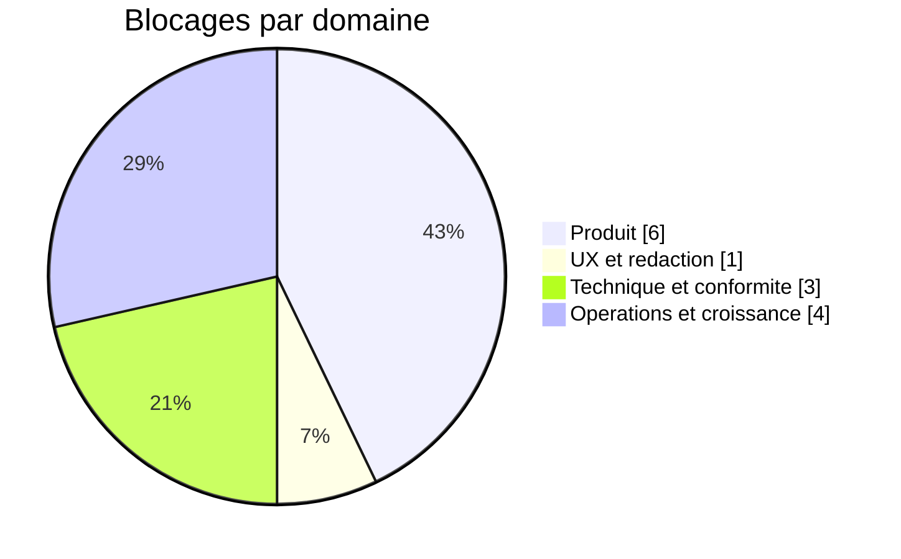

# Cadrer Pro avant le premier code

## Synthèse exécutive

Le cadrage de Pro est **cohérent dans ses principes, insoutenable dans son état actuel** : **210 constats** repris des quatre notes, dont **14 blocages**, dix avant le premier sprint et quatre avant ouverture. **Aucun code ne doit être écrit** avant la sortie de la Phase 0, l'arbitrage des sous-titres du MVP et l'existence d'un dictionnaire de mesures ([HEART, CHI 2010](https://research.google/pubs/pub36299.html?frame=0)). Langues, N2, budget et niveau payant restent ouverts.

| Classe | Constats |
|---|---:|
| Bloquant | 14 |
| Majeur | 97 |
| Mineur | 51 |
| Conforme | 48 |
| **Total** | **210** |

Les 219 occurrences deviennent 210 : neuf redites du paragraphe 8 de la note Produit restent tracées.

Cinq blocages à lever avant le premier sprint :

1. Subordonner la Phase 1 à la sortie de la Phase 0 et chiffrer les seuils H1 à H8 avec validateur (P-1.1, P-3.1).
2. Trancher les sous-titres du MVP ou une transcription validée, et l'écrire au PRD et au parcours B (X-Q8.1, [WCAG 2.2 SC 1.2.2](https://www.w3.org/WAI/WCAG22/Understanding/captions-prerecorded.html)).
3. Publier `mesure.md` avec formules, dénominateurs, événements source et méthode J7 sans identifiant permanent (P-4.1, P-4.2, P-4.3).
4. Spécifier l'identité de session et la table `appeal` avant FS-01, FS-09 et FS-11 (T-1.2, T-3.1).
5. Rendre les décisions auditables : dates, motifs, propriétaires, modèle ADR unique, questions ouvertes séparées (P-2.1, T-1.1).

## Un tableau de bord par domaine conserve les quatorze blocages et leurs corrections

Le rapport ne modifie aucun fichier de `docs` et ne vaut pas validation juridique. Chaque ligne garde l'identifiant du constat dans la note d'origine. Les majeurs sont regroupés par thème, chaque sous-élément restant nommé avec son identifiant. Les bloquants ne sont jamais regroupés. Les redites P-8.1 à P-8.4 renvoient à P-2.1, P-4.1, P-4.2 et P-1.1 ; P-8.5, P-8.6, P-8.7, P-8.8 et P-8.9 renvoient à P-1.2, P-1.3, P-1.5, P-3.4 et P-4.3.

### Produit

| ID | Classe | Fichier | Section | Problème exact | Correction proposée | Source |
|---|---|---|---|---|---|---|
| P-1.1 | Bloquant | `docs/Product/roadmap.md` | l. 6, 18 à 26 | La Phase 1 dépend des ADR, du service vidéo, des emails et de la modération, mais pas de la sortie de la Phase 0, alors que `README.md` l. 34 interdit tout sprint sans histoire rattachée à une opportunité et que la roadmap l. 14 impose une seule opportunité | Ajouter « dépendance : critères de sortie de la Phase 0 validés et opportunité retenue par écrit » et subordonner le premier sprint | [Roadmap](../docs/Product/roadmap.md), [README](../docs/README.md), [Product Talk](https://www.producttalk.org/glossary-discovery-opportunity-solution-tree/) |
| P-2.1 | Bloquant | `docs/Product/decisions.md` | l. 4, 6 à 19 | La règle annonce motif, source, portée et le README exige la date, mais la table n'a que Identifiant, Décision, Statut, Source, Portée ; aucune des douze lignes n'est datée ni motivée | Ajouter Date, Motif, Source liée, Responsable, Historique des révisions, puis renseigner les douze lignes | [Décisions](../docs/Product/decisions.md), [README](../docs/README.md), [ISO/IEC/IEEE 29148](https://standards.ieee.org/standard/29148-2018.html) |
| P-3.1 | Bloquant | `docs/Product/roadmap.md` | l. 14 | « Confirmée, infirmée ou explicitement reportée » n'impose aucun seuil et autorise un report sans date ni responsable, alors que la recherche UX fixe moins de 5 sur 8 pour H1 et plus de 7 sur 10 abandon pour H4 | Reprendre les seuils de `ux-research.md` l. 76 à 83, nommer le validateur et interdire le report au delà du premier sprint sans décision écrite | [Roadmap](../docs/Product/roadmap.md), [UX research](../docs/UX/ux-research.md), [NN/G](https://nngroup.com/articles/ux-goals-analytics/) |
| P-4.1 | Bloquant | `docs/Product/vision.md`, `manifeste.md`, `prd.md` | vision l. 114 à 118, manifeste l. 57, PRD FS-11 | Aucun fichier ne définit nom canonique, formule, dénominateur, événement source, population, période, cible, garde-fou, propriétaire et cadence de revue par mesure | Créer `docs/Product/mesure.md` avant le premier sprint et le rendre source unique dans les trois documents | [HEART](https://research.google/pubs/pub36299.html?frame=0), [NN/G](https://nngroup.com/articles/ux-goals-analytics/) |
| P-4.2 | Bloquant | `docs/Product/vision.md`, `manifeste.md`, `prd.md` | vision l. 114, manifeste l. 57, PRD l. 337 | « Vérifications finalisées pour 1 000 sessions de fil » n'a aucun événement source : FS-11 l. 328 ne contient ni vérification d'identité ni vérification d'organisation, et `signup_verified` est la vérification d'email | Renommer en « inscriptions avec email vérifié pour 1 000 sessions de fil » en phase 1, calculer avec `signup_verified` et `feed_session_start`, créer un événement N2 après arbitrage | [Rest of World, 10 septembre 2026](https://restofworld.org/inside/learned-in-first-months-registration-wall/) |
| P-4.3 | Bloquant | `docs/Product/vision.md`, `manifeste.md` | l. 114 et l. 57 | Le retour à sept jours est exigé alors que le visiteur n'a aucun identifiant permanent (vision l. 56 et 106, PRD l. 373) : une cohorte visiteur à J7 est impossible | Décider que la mesure porte sur les comptes seuls, ou documenter un panel consenti avec conservation ; ne pas laisser les deux règles coexister | [EDPB 4/2019](https://www.edpb.europa.eu/sites/default/files/files/file1/edpb_guidelines_201904_dataprotection_by_design_and_by_default_v2.0_en.pdf) |
| P-1.2, P-8.5 (redite) | Majeur | `vision.md`, `decisions.md`, `prd.md`, `manifeste.md` | vision l. 65, D-008 l. 15, PRD l. 21 et 409, manifeste l. 28 | Français d'abord puis langues marché par marché, contre anglais « dès que possible » retenu puis remis en question ouverte | Écrire une formulation canonique avec déclencheur et date, ou remplacer les deux affirmations anglaises par « langues validées avec chaque marché » | [D-008](../docs/Product/decisions.md), [ISO/IEC/IEEE 29148](https://standards.ieee.org/standard/29148-2018.html) |
| P-1.3, P-8.6 (redite) | Majeur | `vision.md`, `prd.md` | vision l. 58, 71, 72 ; PRD l. 48, 52, 83, 87 | La vision promet badge vérifié, candidature et message au présent, alors que le PRD exclut offres, candidatures et comportement N2 du MVP | Étiqueter « phase 2 » dans la vision ou déplacer N2 dans le MVP avec critères et événements dédiés | [PRD, section 3.2](../docs/Product/prd.md) |
| P-1.4 | Majeur | `vision.md`, `prd.md`, `userflow` produit | vision l. 57, 74 ; PRD l. 97, 328 | « Email ou téléphone, ou connexion sociale » contre spécification email seul dans le parcours A et FS-11 | Écrire « email vérifié en phase 1 ; téléphone et connexion sociale en phase 2, non spécifiés » | [PRD FS-11](../docs/Product/prd.md) |
| P-1.5, P-8.7 (redite) | Majeur | `roadmap.md`, `vision.md`, `decisions.md` | roadmap l. 48 à 54 | La Phase 4 intitule « monde et niveau organisations payant » et en fait un critère de sortie, alors que l'objectif dit « introduire plus tard » et que D-005 limite la gratuité aux phases 1 à 3 | Scinder Phase 4 ouverture monde et Phase 5 monétisation, ou retirer « nom arrêté, privilèges écrits » des critères | [Vision, section 5](../docs/Product/vision.md) |
| P-1.6 | Majeur | `manifeste.md`, `roadmap.md`, `decisions.md` | manifeste l. 31, roadmap l. 52 | Refus d'acheter une meilleure position dans une recherche, contre « offres mises en avant » sans distinguer recherche et fil | Écrire « aucun classement payant dans la recherche ; offres signalées et hors recherche » dans les trois documents | [Manifeste, point 8](../docs/Product/manifeste.md) |
| P-2.2 | Majeur | `decisions.md` | l. 8 à 19 | Sources en texte brut du type « Vision section 5 », sans lien, ligne ni date de consultation | Remplacer par des liens vers sections avec ancre ou numéro de ligne | référence interne Executing Research, note Technique_Conformite |
| P-2.3 | Majeur | `decisions.md` | l. 16 à 18 | D-009, D-010 et D-011 sont des questions ouvertes mélangées à des décisions « retenues » | Déplacer dans une table « Questions ouvertes » avec responsable, phase, déclencheur et date cible | [Hypothesis-driven development](https://blog.logrocket.com/product-management/what-is-hypothesis-driven-development/) |
| P-2.4 | Majeur | `decisions.md` et autres | l. 8 à 19 | Sept décisions structurantes absentes du registre : push N1 et plus, modération en deux temps, 30 jours d'événements, séparation lecture et écriture, taxonomie Brazzaville et Kinshasa, vérification email seule, interdiction du classement payant | Créer D-013 à D-019 avec motif, date, source et portée | [README, règle l. 33](../docs/README.md) |
| P-3.2 | Majeur | `roadmap.md` | l. 24 | Les critères de Phase 1 omettent trois des cinq conditions de la définition de terminé du PRD l. 383 à 389 : cas d'erreur, revue de code, revue d'accessibilité | Renvoyer explicitement à la section 11 du PRD et exiger la trace des revues | [PRD, section 11](../docs/Product/prd.md) |
| P-3.3 | Majeur | `roadmap.md` | l. 34, 36 | Le critère « vérification par domaine ou document légal » décrit la vérification organisation N3, pas le profil N2 ; la dépendance renvoie à une question ouverte | Scinder en N3 vérifiable par domaine et N2 après arbitrage D-010 avec méthode et réversibilité | [Vision, l. 128](../docs/Product/vision.md) |
| P-3.4, P-8.8 (redite) | Majeur | `roadmap.md`, `prd.md` | roadmap l. 44, PRD l. 25 | « Coût par vidéo vue compris dans le budget » est invérifiable, le budget étant non communiqué et absent du registre | Écrire un seuil par vue et par marché ou reporter après décision budgétaire inscrite au registre | [ISO/IEC/IEEE 29148](https://standards.ieee.org/standard/29148-2018.html) |
| P-3.5 | Majeur | `roadmap.md`, `prd.md` | roadmap l. 56 | « Questions ouvertes du PRD tranchées » inclut neuf questions dont la stack et la date de lancement, qui concernent la Phase 1 | Lister seulement D-010, D-011 et les questions propres à la Phase 4 | [Registre](../docs/Product/decisions.md) |
| P-4.4 | Majeur | `vision.md` | l. 116 | Garde-fous « pas de hausse des signalements, pas de compte suspect, pas de plainte, pas de dégradation » sans base ni seuil | Fixer une base issue de la Phase 0 ou des deux premières semaines, puis seuil relatif et fenêtre | [NN/G](https://nngroup.com/articles/product-ux-benchmarks/) |
| P-4.5 | Majeur | `vision.md` | l. 112 à 118 | « Deux parcours » sans taille d'échantillon, unité de randomisation, durée, effet minimal détectable ni propriétaire | Écrire une fiche d'expérimentation avec hypothèse, unité, population, durée, métrique primaire, garde-fous et règle d'arrêt | [HEART](https://research.google/pubs/pub36299.html?frame=0) |
| P-4.6 | Majeur | `vision.md`, `manifeste.md` | l. 114 et l. 57 | « Vidéos vues par session » non défini entre `video_impression` et `video_complete` ; « part des membres qui publient » sans dénominateur | Écrire les deux formules dans le dictionnaire de mesures et aligner les documents | [ISO/IEC/IEEE 29148](https://standards.ieee.org/standard/29148-2018.html) |
| P-5.1 | Majeur | `prd.md` | l. 13 à 27 | La table « Hypothèses de départ » mêle équipe, durée et budget à cinq décisions enregistrées ailleurs (D-004, D-008, D-007, D-005, D-012) avec un statut « retenu » | Scinder en « Décisions héritées du registre » et « Hypothèses à valider » avec méthode, seuil et échéance | [INCOSE via ISO/IEC/IEEE 29148](https://standards.ieee.org/standard/29148-2018.html) |
| P-5.2 | Majeur | `vision.md` | l. 67 à 76 | Phrases de conversion au présent sans statut, dont trois relèvent de la Phase 2 | Ajouter un marqueur de phase devant chaque phrase et relier chaque déclencheur à un événement du plan de mesure | [PRD, section 3.2](../docs/Product/prd.md) |
| P-6.1 | Majeur | `vision.md` | l. 46, référence [8] l. 141 | Attribution « FT Strategies et Global Network Initiative » erronée, partenaire réel Google News Initiative ; Guardian sans source et effet publicitaire non soutenu | Corriger le nom, retirer le Guardian ou le sourcer, reformuler l'effet et dater la publication | [FT Strategies](https://programmes.ftstrategies.com/insights/turning-anonymous-visitors-into-known-users-the-power-of-registration) |
| P-6.2 | Majeur | `vision.md` | l. 32, référence [2] | Comportement TikTok affirmé depuis un guide tiers que la propre liste qualifie de source secondaire | Transformer en hypothèse à tester ou remplacer par la politique officielle | référence interne Executing Research, note Technique_Conformite |
| P-6.3 | Majeur | `vision.md` | l. 34, référence [4] | Détails techniques du mur LinkedIn (IP, referrer, vitesse, forme d'URL) venant d'un blog tiers non daté | Marquer observation non vérifiée ou produire un test daté reproductible | référence interne Executing Research, note Technique_Conformite |
| P-6.4 | Majeur | `vision.md` | l. 132 à 147 | Références [3], [4], [8], [11], [12], [13] sans date de publication ni de consultation | Ajouter une date par entrée et une date de dernier accès pour les pages dynamiques | référence interne Executing Research, note Technique_Conformite |
| P-1.7, P-1.8, P-2.5, P-3.6, P-3.7, P-3.8, P-4.7, P-5.3, P-6.5, P-7.4, P-7.5, P-7.6, P-7.7, P-7.8, P-8.10 | Mineur | `prd.md`, `roadmap.md`, `vision.md`, `README.md`, `manifeste.md` | FS-10 l. 312 et 318, FS-01 l. 148, FS-03 l. 187, FS-08 l. 282, l. 360, 373, 412, README l. 14, vision l. 52 | Quinze défauts de forme ou de clarté : déclencheur push unique ; profil réseau non défini (4G, « réseau correct », FS-08) ; D-012 sous-sourcé ; durées annoncées sans valeur ; « métier ou métier proche » sans taxonomie de proximité ; « nous mesurons le temps » sans p50 ni p95 ; convictions du manifeste non qualifiées ; sur-interprétation de Jay et al. ; alias `usertories.md` non expliqué ; question de préfixe numérique déplacée ; titre « Décision produit » au singulier ; états `blocked` et `reported` mêlant livraison et modération ; conservation des agrégats non définie ; plafond de lecture sans seuil ni phase | Choisir un déclencheur push, publier un profil réseau de référence, compléter les sources, ajouter les durées ou retirer la phrase, publier la taxonomie, définir p50 et p95, qualifier les convictions, réécrire l'interprétation, préciser l'alias, déplacer la question de préfixe, pluraliser le titre, séparer les états, dater la conservation des agrégats, inscrire ou retirer le plafond | [Apple Design Tips](https://developer.apple.com/design/tips), [NN/G](https://nngroup.com/articles/product-ux-benchmarks/), [Jay et al., CHI 2016](https://doi.org/10.1145/2858036.2858319), [EDPB 4/2019](https://www.edpb.europa.eu/sites/default/files/files/file1/edpb_guidelines_201904_dataprotection_by_design_and_by_default_v2.0_en.pdf) |
| P-2.6, P-2.7, P-4.8, P-5.4, P-5.5, P-6.6, P-6.7, P-6.8, P-6.9, P-7.1, P-7.2, P-7.3, P-8.11 | Conforme | Six documents audités | Voir sections 2, 4, 5, 6, 7, 8 | Identifiants D-001 à D-012 uniques, procédure de réouverture complète, FS-11 base utile, données publiées avec réserves, valeurs « à confirmer » signalées, chiffres 62 % et 87 % exacts, recommandations NN/G de 1999 et 2014 présentes, hachage conforme EDPB et ENISA, aucun U+2014 ni U+2013, liens relatifs résolus, numérotation continue, décisions D-004, D-005, D-007, D-012 correctement qualifiées | Conserver tels quels et maintenir les contrôles | [Documents audités](../docs/README.md), [Jay et al.](https://doi.org/10.1145/2858036.2858319), [Rest of World](https://restofworld.org/inside/learned-in-first-months-registration-wall/) |

### UX et rédaction

| ID | Classe | Fichier | Section | Problème exact | Correction proposée | Source |
|---|---|---|---|---|---|---|
| X-Q8.1 | Bloquant | `docs/UX/userflow.md`, `ux-research.md`, `prd.md` | Parcours B, section 12, PRD phase 2 | Sous-titres automatiques reportés en Phase 2 et aucun artefact UX ne prévoit sous-titres ou transcription pour les vidéos avec son du MVP, alors que SC 1.2.2 est niveau A | Trancher avant le code : sous-titrer le MVP, garantir une expérience sans audio par transcription validée, ou exclure le son ; écrire le choix dans le PRD et le parcours B | [W3C WCAG 2.2 SC 1.2.2](https://www.w3.org/WAI/WCAG22/Understanding/captions-prerecorded.html) |
| X-Q1.2, X-Q1.3, X-Q1.4 | Majeur | `ux-research.md` | 7, 4, 11, 7, 8, 12 | Niveaux Faible, Moyenne faible, Moyenne non définis et sans attributaire ; ligne de base annoncée avant protocole de benchmark, avec six sessions J7 et J8 sur prototype alors que les mesures viennent de la télémétrie ; dénominateurs 5 sur 8, 7 sur 10, 6 sur 8, 4 sur 5 incompatibles et aucun test ne garantit dix personnes | Définir une échelle 0 à 3 avec attributaire et date ; séparer ligne qualitative et ligne analytique en disant que la seconde n'existe pas ; choisir un dénominateur par test | [ISO 9241-210:2019](https://www.iso.org/standard/77520.html), [NN/G](https://www.nngroup.com/articles/product-ux-benchmarks/), [HEART](https://static.googleusercontent.com/media/research.google.com/en/us/pubs/archive/36299.pdf) |
| X-Q2.1, X-Q2.2, X-Q2.3, X-Q2.4, X-Q2.5 | Majeur | `ux-research.md` | 5, 7, 8, 9, 12 | RQ1 sans stimulus vidéo et mesure unique de 1 à 5 ; H4 à plus de 7 sur 10 avec six participants ; O4 sans les signaux R7 (59 %, 56 %, 45 %, 38 %) ; H8 « aucune différence » avec quatre personnes par ville ; H6 et H7 exigent cinq créateurs pour deux recrutés | Trois vidéos par secteur avec variation contrôlée ; J8 à dix personnes ou cinq abandons sur six ; construire O4 avec les quatre signaux ; réécrire H8 en signal exploratoire ; réserver cinq créateurs ou réduire l'objectif | [ISO 9241-210:2019](https://www.iso.org/standard/77520.html), [Google Design](https://design.google/library/beyond-the-desktop-field-research), [LinkedIn Safety Pulse 2026](https://news.linkedin.com/2026/LinkedIn-Job-Search-Safety-Pulse) |
| X-Q3.1, X-Q3.2 | Majeur | `ux-research.md` | 8, 12, 16 | 4 + 2 + 2 + 2 = 10 situations annoncées pour huit participants avec chevauchement non précisé ; huit personnes ne peuvent saturer deux villes, quatre situations et six secteurs | Matrice explicite une situation par ville avec chevauchements nommés ; écrire que l'échantillon repère des motifs sans estimer de prévalence et limiter à deux ou trois secteurs | [NN/G Journey Mapping Impact](https://www.nngroup.com/articles/journey-mapping-impact/), [Google Design](https://design.google/library/beyond-the-desktop-field-research) |
| X-Q4.2 | Majeur | `personas.md` | Personne 3 | Chantal reliée à D-010, décision ouverte de Phase 2 et non hypothèse, alors que le profil recruteur est hors MVP | Retirer D-010, garder H5 et marquer « profil exploratoire, hors cycle 1 et hors MVP » | [D-010](../docs/Product/decisions.md), [PRD](../docs/Product/prd.md) |
| X-Q5.1, X-Q5.2, X-Q5.3, X-Q5.4, X-Q5.5 | Majeur | `userflow.md` | Parcours A, B, C | Absence du refus de lecture automatique et de fin de session ; six embranchements manquants (FS-03 suggestion, FS-05 visiteur, FS-06 limite de commentaires, FS-08 état vide, FS-07 envoi à soi et limite de 20 messages) ; états `draft`, `uploading`, `rejected` absents ; règle de blocage après réception absente du PRD ; demande push et lien depuis notification non montrés | Ajouter les embranchements avec libellés d'erreur, nommer les états et la contestation, déplacer la règle de blocage dans FS-07 ou la marquer hypothèse, placer le point push après la première action significative | [PRD FS-01, FS-03 à FS-10](../docs/Product/prd.md), [README](../docs/README.md) |
| X-Q6.2, X-Q6.3, X-Q6.4, X-Q6.5 | Majeur | `userstories.md` | En-tête, règle 6, US-06, US-16 | P0 et P1 non définis et US-10 en P1 alors que FS-10 est au MVP ; aucune colonne opportunité ou H malgré la règle 3 et le README ; US-06 suggère une personnalisation exclue du MVP ; US-16 priorisée sur une section ouverte et D-010 | Définir P0 et P1 et passer US-10 en P0 ; ajouter la colonne opportunité ; réécrire US-06 ; retirer la priorité de US-16 | [PRD](../docs/Product/prd.md), [UX research, section 9](../docs/UX/ux-research.md) |
| X-Q7.2 | Majeur | `ux-research.md` | 10 | Le tableau « Parcours à valider, version provisoire » recopie le parcours A et ajoute des pensées hypothétiques, créant deux représentations du même chemin | Remplacer par un lien vers le parcours A et garder seulement frictions et émotions avec identifiants H | [NN/G Research Repositories](https://www.nngroup.com/videos/research-repositories-101/), [README](../docs/README.md) |
| X-Q8.2, X-Q8.3 | Majeur | `userflow.md`, `ux-research.md` | Parcours A à D, section 13 | Aucun parcours ne traite lecteur d'écran, ordre de focus, contraste, mouvement réduit ni taille de cible ; PRD cite 44 pixels sans nommer WCAG 2.2 AA à 24 sur 24 CSS px ; cycle de vie des notes, base légale, responsable, date limite de retrait et traitement des citations absents | Ajouter une ligne accessibilité par parcours et un tableau donnée, finalité, conservation, accès, suppression avec relecture des citations et retrait jusqu'à J10 | [W3C SC 2.5.8](https://www.w3.org/WAI/WCAG22/Understanding/target-size-minimum.html), [Apple HIG](https://developer.apple.com/design/human-interface-guidelines/design-principles), [ISO 9241-210:2019](https://www.iso.org/standard/77520.html) |
| X-Q9.1, X-Q9.2, X-Q9.3 | Majeur | `userflow.md`, `ux-research.md` | Ensemble, 1, 6, 8, 13 | Pas de carte de parcours visuelle avec acteur, scénario, phases, courbe émotionnelle et opportunités ; pas de principes de design propres à Pro ; pas d'emplacement ni de nommage pour notes, stimuli, consentements, grille de codage et versions du guide | Créer `journey-map.md`, `design-principles.md` en cinq à huit principes et un référentiel de recherche P1 à P12 ; relier chaque creux à O1 à O5 | [NN/G Journey Mapping 101](https://www.nngroup.com/articles/journey-mapping-101/), [Apple HIG](https://developer.apple.com/design/human-interface-guidelines/design-principles), [NN/G Research Repositories](https://www.nngroup.com/videos/research-repositories-101/) |
| X-Q2.6, X-Q3.4, X-Q4.3, X-Q4.4, X-Q5.6, X-Q6.6, X-Q7.3, X-Q7.4, X-Q9.7, X-Q9.8, X-Q9.9, X-Q9.10, X-Q9.11 | Mineur | `ux-research.md`, `personas.md`, `ia-defauts-et-tips.md` | Sections 8, 9, 12, 15 ; personnes 1 à 5 ; paragraphes 1, 6, 7, 17 | Treize défauts : « trio » pour quatre fonctions ; langue d'usage absente du questionnaire ; fictionalité locale manquante sur deux personas ; signaux recopiés ; contestation décrite comme simple lien ; P1 en Phase 2 non expliqué ; doublons personas et grille typo limitée ; « tuées » au lieu d'infirmées ; six principes attribués à Apple au lieu de huit ; étude de 2024 rapportée comme 2025 ; classificateur OpenAI appuyé sur un blog commercial ; URL Adobe opaque | Corriger les termes, ajouter les mentions de fictionalité, remplacer les listes par une tension et un identifiant H, étendre la grille, clarifier les sources et préférer l'URL publique LinkedIn | [Google Design](https://design.google/library/beyond-the-desktop-field-research), [Apple HIG](https://developer.apple.com/design/human-interface-guidelines/design-principles), [WWDC26](https://developer.apple.com/videos/play/wwdc2026/250), [OpenAI](https://openai.com/index/new-ai-classifier-for-indicating-ai-written-text), [The Conversation, juillet 2025](https://theconversation.com/too-many-em-dashes-weird-words-like-delves-spotting-text-written-by-chatgpt-is-still-more-art-than-science-259629) |
| X-Q1.1, X-Q1.5, X-Q2.7, X-Q3.3, X-Q4.1, X-Q5.7, X-Q6.1, X-Q7.1, X-Q7.5, X-Q8.4, X-Q8.5, X-Q9.4, X-Q9.5, X-Q9.6 | Conforme | Six fichiers UX et `ia-defauts-et-tips.md` | Sections 1, 2, 6, 7, 15, 16 ; guide ; parcours D ; contrôle mécanique | Séparation faits, hypothèses, décisions et inconnues ; cohérence des décisions D-001, D-005, D-007, D-012 ; guide sans questions suggestives ; douze recrutés dont quatre réserves ; garde-fous des personas ; douze événements couverts ; seize histoires traçables ; alias fonctionnel ; critères non dupliqués ; consentement et signalement visiteur ; zéro U+2014 et U+2013, liens résolus, chiffres externes concordants | Conserver et reporter dans les protocoles J2 et J7 et J8 | [Fichiers UX](../docs/UX/ux-research.md), [Graphite](https://graphite.io/research/ai-tells), [TextPulse](https://textpulse.ai/research/ai-style-fingerprints) |

### Technique et conformité

| ID | Classe | Fichier | Section | Problème exact | Correction proposée | Source |
|---|---|---|---|---|---|---|
| T-1.1 | Bloquant | `docs/Technique/README.md` | l. 20 | « Contexte, options, décision, conséquences » mélange Nygard et MADR ; statut, propriétaire et date absents, donc décision non auditable ni remplaçable | Choisir un modèle : Nygard avec Titre, Statut, Contexte, Décision, Conséquences, Propriétaire, Date, ou MADR avec les mêmes champs de gouvernance | [Nygard, 2011](https://www.cognitect.com/blog/2011/11/15/documenting-architecture-decisions), [MADR](https://adr.github.io/madr/) |
| T-1.2 | Bloquant | `Technique/README.md`, `prd.md` | Table, FS-11, sections 8 et 10 | Aucune fiche ne décide du modèle d'identité visiteur : format du jeton, durée de vie, rotation, portée, dérivé pseudonyme, liaison à `signup_verified`, comportement du jeton push ; `securite.md` trop général et trop tardif | Ajouter `adr-002-identite-session.md` avant FS-01 avec jeton court non durable, clé par finalité, règle de liaison explicite et interdiction de jeton push visiteur | [RGPD article 5](https://gdpr-info.eu/art-5-gdpr/), [EDPB 4/2019](https://www.edpb.europa.eu/sites/default/files/files/file1/edpb_guidelines_201904_dataprotection_by_design_and_by_default_v2.0_en.pdf), [PRD FS-11](../docs/Product/prd.md) |
| T-3.1 | Bloquant | `prd.md` | Section 8, table `report`, FS-09, section 9 | L'état `appealed` et la contestation par lien unique existent, mais aucune table ne stocke jeton, expiration, usage unique, texte de recours ni décision finale | Ajouter `appeal` avec identifiant, signalement, empreinte du jeton, création, expiration, texte, état, décision, motif, utilisateur qui a statué, et lier `moderation_action` | [PRD FS-09](../docs/Product/prd.md), [DSA article 20](https://www.springlex.eu/en/packages/dsa/dsa-regulation/article-20/) si Union européenne |
| T-1.3, T-1.4, T-1.5, T-1.6, T-1.7 | Majeur | `Technique/README.md`, `architecture.md`, `observation.md`, `Conformite/README.md`, `vision.md` | Sections variées | Mécanisme d'invalidation de cache non décidé malgré « un cache n'est pas une autorisation » ; publication automatique sans acteur ni journal ; mesure sans passage objectifs signaux mesures ; périmètre juridique et région non découplés de l'hébergeur ; aucune modélisation de menaces | Écrire le contrôle de visibilité avec diagramme C4 conteneur et test de non régression ; créer `adr-003-porte-publication.md` avec acteurs `system`, `moderateur`, `auteur` ; table HEART ; `perimetre-juridique.md` ; `menaces.md` avant `securite.md` et `architecture.md` | [C4 model](https://c4model.com/), [Google HEART](https://research.google.com/pubs/measuring-the-user-experience-on-a-large-scale-user-centered-metrics-for-web-applications/), [OWASP](https://owasp.org/www-community/Threat_Modeling), [RGPD article 3](https://gdpr-info.eu/art-3-gdpr/) |
| T-2.1, T-2.2, T-2.3, T-2.4, T-2.5 | Majeur | `Technique/README.md`, `Conformite/README.md` | l. 10, 15, 14, 14 et 15 | Dépendances non explicites : architecture déclenchée seulement après l'ADR stack ; `performance.md` après la revue MVP ; `observation.md` avant la première mesure donc après FS-11 ; `securite.md` après FS-07 et FS-09 alors que FS-01 et FS-02 sont déjà exposés ; périmètre non lié à la première migration | Ajouter une colonne Dépendances ; déplacer performance avant architecture et vidéo, observation avant FS-11, socle sécurité et menaces avant FS-01 et FS-02, périmètre avant `adr-001-stack` et migration | [Stream](https://getstream.io/blog/build-a-social-media-app/), [OWASP](https://owasp.org/www-community/Threat_Modeling), [PRD](../docs/Product/prd.md) |
| T-3.2, T-3.3, T-3.4, T-3.5, T-3.6, T-3.7, T-3.8, T-3.9 | Majeur | `prd.md` | Section 8 et FS-02 à FS-11 | Corps du commentaire de 280 caractères sans support ; table `block` absente ; aucun magasin pour `analytics_event` ; jeton push persistant non représenté et rattachable à un visiteur ; événements visiteurs potentiellement rattachés au compte ; transition vers `rejected` sans acteur ni notification ; `moderation_action` sans acteur `system` ; délai de contestation non chiffré ni propriétaire d'exception | Ajouter `comment`, `block`, `analytics_event`, `push_subscription` réservé au compte, table de transitions, acteur `system` avec règle journalisée et table de conservation par objet | [PRD](../docs/Product/prd.md), [Stream](https://getstream.io/blog/build-a-social-media-app/), [EDPB 4/2019](https://www.edpb.europa.eu/sites/default/files/files/file1/edpb_guidelines_201904_dataprotection_by_design_and_by_default_v2.0_en.pdf) |
| T-4.1, T-4.2, T-4.3, T-4.4 | Majeur | `prd.md`, `vision.md` | Sections 10 et 12, section 8 | Coût pour 1 000 vidéos sans octets, bitrates, cache, pays, fournisseur ni période ; budget inconnu mais question non bloquante ; modération réduite à une alerte de file ; indicateurs sans base, seuil, échantillon ni règle d'arrêt | Définir octets et coût par 1 000 vues, taux de hit cache et part en qualité réduite ; rendre le budget bloquant pour `video.md` ; ajouter volume, âge médian et p95, délai de première décision, taux de contestation et de renversement ; table HEART avec propriétaire | [Google HEART](https://research.google.com/pubs/measuring-the-user-experience-on-a-large-scale-user-centered-metrics-for-web-applications/), [DSA article 20](https://www.springlex.eu/en/packages/dsa/dsa-regulation/article-20/) |
| T-5.2, T-5.3, T-5.4 | Majeur | `vision.md`, `Conformite/README.md`, `prd.md` | Section 7, table entière, section 3.3 | « Le DSA impose ces obligations » englobe une relecture préalable que les articles 16, 17 et 20 n'imposent pas ; aucune fiche conformité n'a champ Source ni propriétaire ; RGPD au démarrage dans les deux Congo non tranché | Reformuler en régime applicable sous validation conseil ; ajouter Sources primaires et Propriétaire de validation ; séparer choix produit, texte cité et point à valider dans `perimetre-juridique.md` | [DSA article 16](https://www.eu-digital-services-act.com/Digital_Services_Act_Article_16.html), [article 17](https://www.springlex.eu/en/packages/dsa/dsa-regulation/article-17/), [article 20](https://www.springlex.eu/en/packages/dsa/dsa-regulation/article-20/), [RGPD article 3](https://gdpr-info.eu/art-3-gdpr/) |
| T-6.1, T-6.2, T-6.3, T-6.4 | Majeur | Les deux README, `donnees.md`, `conservation.md`, `securite.md`, `prd.md` | Tables et section 11 | Analyse de menaces absente (redite de T-1.7) ; double propriété conservation entre Technique et Conformité ; aucune matrice de responsabilités pour ADR, revue de confidentialité, escalade, signature locale et budget ; six menaces non listées | Désigner `conservation.md` source de la politique et `donnees.md` traduction ; créer `responsabilites.md` en RACI ; lister abus de téléversement, rejeu de jeton, gratage du fil, abus du lien de contestation, harcèlement en chat et fuite du jeton push | [OWASP](https://owasp.org/www-community/Threat_Modeling), [OWASP ASVS](https://owasp.org/projects/asvs), [RGPD article 5 §2](https://gdpr-info.eu/art-5-gdpr/) |
| T-7.1, T-7.2, T-7.3, T-7.4 | Majeur | `prd.md`, `vision.md` | FS-09, parcours D, sections 8 et 10 | Signalant visiteur sans notification ni recours ; « journal complet » sans intégrité, contrôle d'accès, conservation ni masquage ; référence pseudonyme sans définition de clé, portée, rotation ni séparation d'avec la clé analytique ; lien de contestation sans expiration ni usage unique | Décider recours anonyme ou absence écrite de recours ; journal en ajout seul avec accès limité et horodatage fiable ; clé dédiée à la modération et interdiction de jointure avec `signup_verified` ; empreinte du jeton et révocation après décision | [DSA article 20](https://limenia.eu/en/guides/dsa-internal-complaint-handling/), [OWASP ASVS](https://owasp.org/projects/asvs), [EDPB 4/2019](https://www.edpb.europa.eu/sites/default/files/files/file1/edpb_guidelines_201904_dataprotection_by_design_and_by_default_v2.0_en.pdf) |
| T-8.2 | Majeur | `prd.md` | Section 10, « Accessibilité » | « Contrastes conformes » et « 44 pixels » sans norme ni niveau, alors que WCAG 2.2 AA exige 24 sur 24 CSS px et que 44 sur 44 relève du AAA | Écrire niveau AA visé, 44 pixels comme objectif au delà du minimum AA et ratio de contraste visé | [W3C SC 2.5.8](https://www.w3.org/WAI/WCAG22/Understanding/target-size-minimum.html), [WCAG 2.2 SC 1.4.3](https://www.w3.org/TR/WCAG22/#contrast-minimum) |
| T-1.8, T-1.9, T-2.6, T-3.10, T-4.5, T-4.6, T-5.5, T-5.6, T-6.5, T-7.5, T-8.3, T-8.4, T-8.5, T-8.6, T-8.7, T-8.8, T-8.9 | Mineur | Les deux README, `video.md`, `prd.md`, `vision.md`, `Conformite/README.md` | Lignes 12, 13, 20 ; sections 9, 10, 12, 13 | Dix-sept défauts recensés, dont plusieurs redites entre notes : EXIF non retiré ; colonnes Propriétaire, Statut, Date absentes ; glossaire de phases ; état `message` mêlant livraison et modération ; dénominateur « session de fil » non lié ; risque mur de connexion ambigu ; renvoi UE sans articles ; statut EDPB 01/2025 non vérifié ; critère ASVS absent de la définition de terminé ; rôle signalant absent ; modèle ADR formulé de façon débutante ; « ADR d'architecture » contre `adr-001-stack.md` ; préfixe numérique ; « validation automatique » ambiguë | Ajouter les colonnes et le glossaire, séparer les champs d'état, lier le dénominateur à `feed_session_start` et à la durée de session, reformuler le test du mur, vérifier EDPB 01/2025, ajouter ASVS, nommer le signalant, harmoniser les noms d'ADR | [Nygard](https://www.cognitect.com/blog/2011/11/15/documenting-architecture-decisions), [EDPB 01/2025](https://www.edpb.europa.eu/system/files/documents/webform/public_consultation_reply/comments-on-the-guidelines-01-2025-on-pseudonymisation.pdf), [OWASP ASVS](https://owasp.org/projects/asvs) |
| T-1.10, T-2.7, T-2.8, T-3.11, T-4.7, T-5.1, T-5.7, T-6.6, T-7.6, T-8.1, T-8.10 | Conforme | `Technique/README.md`, `Conformite/README.md`, `prd.md`, `vision.md` | Lignes 4, 5, 9, 13, 15 ; sections 8, 10, 11 | Règle « le PRD ne choisit pas la stack » ; `adr-001-stack.md` avant sprint 1 ; données et conservation avant migration ; `guest_session` et visibilité du profil cohérentes ; événements FS-11 complets ; règle de non invention juridique ; conseil local exigé ; limites de sécurité chiffrées ; chaîne FS-09 de bout en bout ; zéro U+2014 ni U+2013 ; statut « aucun document rédigé » explicite | Conserver sans modification | [Documents audités](../docs/Technique/README.md), [Conformité](../docs/Conformite/README.md) |

### Opérations et croissance

| ID | Classe | Fichier | Section | Problème exact | Correction proposée | Source |
|---|---|---|---|---|---|---|
| O-1.1 | Bloquant | `docs/Operations/README.md` | Statut et première action, l. 4, 5, 18 | Aucun document rédigé, première action limitée à une page de journée type, sans volume, rôle, temps par ticket, priorisation, délai ni escalade | Rédiger `journee-type-moderation.md` avant tout lien public avec volume par ville et motif, rôle nominé, temps cible, seuil d'alerte et délai d'escalade ; en faire la condition 6 de la section 11 du PRD | [Google SRE](https://sre.google/resources/practices-and-processes/incident-management-guide), [Ops README](../docs/Operations/README.md) |
| O-1.2 | Bloquant | `docs/Product/prd.md` | Section 11, l. 383 à 389 | Les cinq conditions de terminé sont produit ou technique et aucune ne vérifie file armée, modérateur joignable ou test de file | Ajouter revue de la journée type, astreinte nominée, test à blanc du signalement visiteur jusqu'à la notification d'auteur et validation du délai cible | [Google SRE, Managing Incidents](https://sre.google/sre-book/managing-incidents), [PRD](../docs/Product/prd.md) |
| O-6.1 | Bloquant | `Operations/README.md` | Tableau, aucun document dédié | Aucune astreinte : pas de tour de garde, contact d'urgence, titulaire ni passation, alors que le PRD prévoit des alertes sans destinataire nommé | Créer `astreinte.md` avant la première mise en ligne avec rôles coordinateur, communication, opérations, rotation hebdomadaire, canal unique, numéro d'urgence, passation et exercice à blanc | [Google SRE](https://sre.google/resources/practices-and-processes/incident-management-guide), [SRE Workbook](https://sre.google/workbook/incident-response) |
| O-6.3 | Bloquant | `Operations/README.md`, `Growth/README.md` | Aucun document dédié | Aucun plan de montée en charge pour le volume de modération, le trafic vidéo et le coût CDN, alors que la section 12 demande une mesure sans seuil ni propriétaire | Créer `montee-en-charge.md` avec courbe de trafic et de signalements par ville, seuils de bascule, budget CDN, capacité de modération, action par seuil et propriétaire | [Google SRE](https://sre.google/resources/practices-and-processes/incident-management-guide), [Google Cloud](https://docs.cloud.google.com/architecture/framework/operational-excellence/manage-incidents-and-problems) |
| O-1.3, O-1.4, O-2.1, O-2.2, O-2.3 | Majeur | `prd.md`, `Operations/README.md` | FS-09 l. 293, section 12 l. 399, section 10 l. 379, FS-10 | Priorité « selon motif et nombre » sans formule ni délai ; alerte de file sans seuil, âge ni destinataire ; canal FS-09 et FS-10 non hiérarchisé avec risque d'affichage de sanction sur écran verrouillé ; délai de contestation non chiffré ; aucun second relecteur | Matrice P1 à P3 avec délai de prise en charge et effectif ; deux signaux actionnables avec destinataire ; email canonique avec motif et délai, push neutre, bandeau pour membres connectés ; délai unique avec horodatage et sort de la vidéo ; relecture par une deuxième personne | [Reddit](https://support.reddithelp.com/hc/articles/23511059871252-Content-Moderation-Enforcement-and-Appeals), [Commission européenne](https://digital-strategy.ec.europa.eu/en/faqs/dsa-transparency-database-questions-and-answers), [EDPB 3/2025 §24](https://www.edpb.europa.eu/system/files/2026-09/edpb_guidelines_202503_interplay-dsa-gdpr_v2_en.pdf), [Roblox](https://en.help.roblox.com/hc/en-us/articles/360000245263-Appeal-Your-Content-or-Account-Moderation) |
| O-3.2, O-3.3 | Majeur | `Growth/README.md`, `Operations/README.md`, `ux-research.md` | `messagerie.md` l. 12, veille l. 14, R7 et O4 | Liste fermée de claims interdits absente alors que le MVP n'a ni offres ni vérification au delà de l'email ; veille arnaque après les premiers signalements alors que 22 % et 21 % des professionnels craignent les arnaques et que l'avertissement chat n'est pas au FS-07 | Ajouter liste fermée et validation écrite par ville ; avancer `veille-arnaque.md` avant ouverture, rédiger les avertissements et arbitrer l'ajout à FS-07 | [FTC, juillet 2025](https://consumer.ftc.gov/consumer-alerts/2025/07/job-scammers-are-looking-hire-you), [Indeed](https://www.indeed.com/news/releases/how-to-spot-and-avoid-job-offer-scams), [LinkedIn Safety Pulse 2026](https://news.linkedin.com/2026/LinkedIn-Job-Search-Safety-Pulse) |
| O-4.1, O-4.2 | Majeur | `Growth/README.md`, `prd.md` | `lanceurs-metiers.md` l. 10, section 12 l. 395 | Trois métiers par ville sans cible chiffrée ni seuil de fil non vide ; aucun engagement de publication sur deux semaines ni relance | Fixer cible par ville vérifiée avec `video_published`, prévoir repli vers le fil général, ajouter engagement minimal, calendrier de relance et propriétaire | [LogRocket](https://blog.logrocket.com/ux-design/using-concept-testing-product-design), [LaunchList](https://getlaunchlist.com/blog/fake-door-test), [HEART](https://research.google.com/pubs/archive/36299.pdf) |
| O-5.1, O-5.2, O-5.3 | Majeur | `prd.md`, `Growth/README.md`, `ux-research.md` | FS-11 l. 328, 329, section 10 l. 379, UX l. 214 à 220 | Événements sans `city`, `trade` ni `campaign_ref` alors que `guest_session` les porte et que deux documents exigent une ventilation ; aucun événement de modération ; dénominateur engagement changeant de nature après `signup_verified` | Ajouter les trois champs avec conservation de trente jours et aucun identifiant d'appareil ; ajouter `report_resolved`, `moderation_action`, `appeal_opened`, `appeal_resolved`, `queue_depth`, `report_age` ; interdire la fusion des deux dénominateurs | [Base DSA transparence](https://transparency.dsa.ec.europa.eu/page/documentation), [EDPB 3/2025](https://www.edpb.europa.eu/system/files/2026-09/edpb_guidelines_202503_interplay-dsa-gdpr_v2_en.pdf), [Google SRE](https://sre.google/resources/practices-and-processes/incident-management-guide) |
| O-6.2, O-6.4 | Majeur | `Operations/README.md`, `prd.md` | `incidents.md` l. 12, section 12 l. 396, 399 | Registre d'incidents sans schéma de gravité, ville, fonction, heure, décideur, action ni postmortem ; coût vidéo et roulement bénévole ou salarié sans seuil ni responsable | Définir schéma et postmortem sans blâme avec actions datées ; transformer chaque mesure en règle seuil, propriétaire, action, délai | [Google SRE](https://sre.google/resources/practices-and-processes/incident-management-guide), [SRE Book](https://sre.google/sre-book/managing-incidents) |
| O-7.1, O-7.2 | Majeur | `Growth/README.md`, `Operations/README.md`, `prd.md` | `acquisition-congo.md` l. 9, tableau l. 9 à 14, section 2 l. 22 | Un seul document couvre les deux villes et aucun document opérationnel ne les distingue ; la ligne d'hypothèses unique traite deux pays comme une entrée « retenue » | Scinder en acquisition Brazzaville et Kinshasa avec cibles et partenaires distincts ; ajouter une colonne ville dans les documents opérationnels ; dédoubler les hypothèses sans changer le périmètre produit | [Rest of World, 2025](https://restofworld.org/2025/linkedin-job-scams), [UX section 16](../docs/UX/ux-research.md) |
| O-2.4, O-4.3, O-5.4, O-8.3, O-8.4, O-8.5 | Mineur | `Operations/README.md`, `ux-research.md`, `prd.md`, `Growth/README.md` | `contestation.md` l. 10, section 8 l. 100 à 102, FS-11 l. 336, section 12 l. 398, J9 l. 97 | Preuve de réception sans champs ; passage de six secteurs à trois métiers non tracé ; catégories d'événements anonymes et rattachées sans base ni durée ; risque mur lu littéralement malgré FS-01 ; « hypothèses tuées » ; nom `messagerie.md` confondu avec FS-07 | Ajouter les champs de ticket, critère de sélection des métiers, base et durée par catégorie, reformuler le test avec `app_open` et `feed_session_start`, dire « infirmées », renommer en `phrases-invitation.md` | [arXiv](https://info.arxiv.org/help/moderation/appeals.html), [EDPB 3/2022](https://www.edpb.europa.eu/system/files/documents/2023-02/edpb_03-2022_guidelines_on_deceptive_design_patterns_in_social_media_platform_interfaces_v2_en_0.pdf), [PRD FS-01](../docs/Product/prd.md) |
| O-1.5, O-2.5, O-3.1, O-3.4, O-4.4, O-5.5, O-6.5, O-7.3, O-8.1, O-8.2 | Conforme | `Operations/README.md`, `Growth/README.md`, `prd.md`, `ux-research.md` | Lignes 5, 9, 10 ; section 3.2 ; FS-11 ; H8 et section 12 | File dès le MVP ; ticket pseudonyme, journal et nouveau ticket lié ; gratuité à 100 % pendant acquisition ; absence d'offres au MVP ; H8 et attribution par ville ; pas d'identifiant d'appareil ni de traceur tiers ; conservation à trente jours ; observability technique ; recrutement six et six ; zéro U+2014 ni U+2013 et liens locaux résolus | Conserver comme socle et y brancher seuils et astreinte | [Documents audités](../docs/Operations/README.md), [Growth](../docs/Growth/README.md) |

## La matrice transverse révèle trois boucles de contradiction

Trois boucles structurent le diagnostic. La première va de la vision vers le registre de décisions et le PRD : la vision écrit des scénarios de Phase 2 au présent, le PRD les exclut du MVP et le registre fige D-008 alors que le PRD rediscute la langue ([ISO/IEC/IEEE 29148](https://standards.ieee.org/standard/29148-2018.html)). La deuxième va de la recherche vers la roadmap : les règles internes imposent une opportunité par histoire, mais la roadmap fait entrer FS-01 à FS-11 avant la validation H1 à H8 ([Product Talk](https://www.producttalk.org/glossary-discovery-opportunity-solution-tree/)). La troisième va de la mesure vers la confidentialité : le produit veut un retour à sept jours et des vérifications pour 1 000 sessions, alors qu'il interdit l'identifiant permanent visiteur et ne prévoit aucun événement de vérification ([EDPB 4/2019](https://www.edpb.europa.eu/sites/default/files/files/file1/edpb_guidelines_201904_dataprotection_by_design_and_by_default_v2.0_en.pdf)).

| Axe | Alignement | Contradiction ou lacune | Effet sur le sprint | Trace |
|---|---|---|---|---|
| Vision, PRD, décisions | Mobile et web ensemble (D-004), gratuité (D-005), deux Congo (D-007), aucun identifiant visiteur (D-012) sont cohérents | Langues (D-008), N2, inscription, monétisation et classement payant divergent | Deux sources de vérité sur le périmètre MVP | P-1.2 à P-1.6, P-5.1, P-5.2 |
| Roadmap, README, recherche UX | Phases 0 à 4 numérotées, critères présents | Aucune dépendance Phase 0 vers Phase 1, seuils H1 à H8 sans valeur | Sprint démarrable sans validation | P-1.1, P-3.1, X-Q1.4 |
| PRD, userflow, userstories | Douze événements couverts, seize histoires liées à une FS | Six branches d'erreur absentes, opportunité absente des histoires, US-16 priorisée sur D-010 ouverte | Développement d'un chemin nominal seul | X-Q5.1 à X-Q5.5, X-Q6.2 à X-Q6.5 |
| Mesure, vision, FS-11, observation | Liste d'événements utilisable | Métrique phare sans événement, J7 impossible, garde-fous sans seuil | Instrumentation figée sur de mauvaises formules | P-4.1 à P-4.6, T-1.5, O-5.1 à O-5.3 |
| Vision, Technique, Conformité | « Un cache n'est pas une autorisation » et distinction lecture et écriture cohérentes | Mécanisme d'invalidation absent ; DSA présenté comme imposant une relecture préalable ; périmètre RGPD non tranché | Architecture et juridique découplés du marché réel | T-1.3, T-5.2 à T-5.4 |
| Opérations, Croissance, UX | Règle de gratuité et garde-fou H8 sur les deux villes | Acquisition et modération fusionnent les villes, veille arnaque après signalements | Extrapolation et avertissements absents du chat | O-3.3, O-7.1, O-7.2 |
| Croissance, PRD, manifeste | Gratuité totale, pas d'offres d'emploi au MVP | Claims interdits non listés, seuil de semis non chiffré | Promesse non tenable par le produit | O-3.2, O-4.1 |
| PRD, Technique, Conformité | Données et conservation déclenchées avant migration | Double propriété `donnees.md` et `conservation.md`, table `appeal` absente, identité visiteur non décidée | Migration code des choix implicites | T-1.2, T-3.1, T-6.2 |

## Une architecture documentaire distincte par métier cadre le avant code

Les trois états distingués sont : **existe et doit être corrigé**, **manquant et bloquant**, **manquant et différé**. Le classement de gravité des notes est conservé dans la colonne Classe. Un document « manquant et bloquant » l'est soit avant le premier sprint, soit avant la première migration, soit avant l'ouverture publique, et le jalon est précisé.

### Product

| Document | État | Classe | Rôle | Déclencheur | Argument |
|---|---|---|---|---|---|
| `README.md` | Existe et doit être corrigé | Mineur | Règles de mise à jour, typographie, organisation | Immédiat, avant toute correction | Règle l. 33 et 34 déjà invoquée par les autres dossiers, alias `usertories.md` à préciser |
| `vision.md` | Existe et doit être corrigé | Bloquant et majeur | Promesse produit, niveaux d'accès, garde-fous, limitations | Avant arbitrage des langues et de N2 | Porte les blocages P-4.1 à P-4.3 et les scénarios Phase 2 au présent |
| `manifeste.md` | Existe et doit être corrigé | Majeur | Engagements de conception, interdiction du classement payant | Avec la vision | Quatre contradictions et quatre mesures mal définies |
| `prd.md` | Existe et doit être corrigé | Bloquant | FS-01 à FS-11, modèle de données, événements, définition de terminé | Avant FS-01, FS-09 et FS-11 | Support manquant de `appeal`, `comment`, `block`, `analytics_event`, `push_subscription` |
| `roadmap.md` | Existe et doit être corrigé | Bloquant | Phases, dépendances, critères de sortie | Avant le premier sprint | Sans dépendance Phase 0 ni seuils H1 à H8, la sortie de phase n'est pas vérifiable |
| `decisions.md` | Existe et doit être corrigé | Bloquant | Registre des décisions et questions ouvertes | Avant le premier sprint | Aucune date ni motif, D-009 à D-011 mélangés, sept décisions absentes |
| `mesure.md` | Manquant et bloquant | Bloquant | Dictionnaire canonique, formules, événements source, cibles, garde-fous | Avant instrumentation de FS-11 | Trois blocages de mesure dépendent de ce seul artefact |
| Fiche d'expérimentation | Manquant et bloquant | Majeur | Hypothèse, unité, population, durée, règle d'arrêt | Avant le premier test A et B | Le test à deux parcours ne peut être décidé sans règle écrite |
| Tableau de bord | Manquant et différé | Lacune signalée | Lecture des mesures | Après `mesure.md`, avant première mesure | FS-11 le suppose sans qu'aucun livrable de roadmap ne le mentionne |

### UX

| Document | État | Classe | Rôle | Déclencheur | Argument |
|---|---|---|---|---|---|
| `ux-research.md` | Existe et doit être corrigé | Bloquant et majeur | Décisions, preuves, hypothèses H1 à H8, opportunités O1 à O5, consentement | Avant la Phase 0 | Échelle de confiance, dénominateurs et protocole J7 et J8 non opérationnels |
| `personas.md` | Existe et doit être corrigé | Majeur et mineur | Supports de discussion, profils fictifs | Avant cycle 1 | D-010 traité comme hypothèse et cartes hors cycle non marquées |
| `userflow.md` | Existe et doit être corrigé | Bloquant et majeur | Parcours A à D et branches d'erreur | Avant écriture de FS-01 à FS-10 | Sous-titres absents et six branches du PRD manquantes |
| `userstories.md` | Existe et doit être corrigé | Majeur | Backlog lisible lié aux FS | Avant constitution du sprint | P0 et P1 non définis, colonne opportunité absente |
| `usertories.md` | Existe et doit être corrigé | Conforme et mineur | Alias de renvoi | Avec `README.md` | Lien fonctionnel, nature de l'alias à expliciter |
| `design-principles.md` | Manquant et différé | Majeur | Cinq à huit principes opposables avant revue d'interface | Après arbitrage des sous-titres et des parcours | Apple sert de grille de critique, Pro n'a pas de principes propres |
| `journey-map.md` | Manquant et différé | Majeur | Acteur, scénario, phases, courbe émotionnelle, opportunités | Après correction des parcours | La section 10 de la recherche n'en tient pas lieu |
| Référentiel de recherche | Manquant et différé | Majeur | P1 à P12, sessions, stimuli, notes, consentements, versions du guide | Après J2 | Sans emplacement ni nommage, la preuve d'une hypothèse n'est pas archivable |

### Redaction

| Document | État | Classe | Rôle | Déclencheur | Argument |
|---|---|---|---|---|---|
| `ia-defauts-et-tips.md` | Existe et doit être corrigé | Mineur | Grille de relecture, défauts de style, sources de stylométrie | Avant chaque commit documentaire | Périmètre limité à vision et manifeste, datation de l'étude et source primaire du classificateur à corriger |

Les notes n'identifient aucun document manquant dans ce dossier.

### Technique

| Document | État | Classe | Rôle | Déclencheur | Argument |
|---|---|---|---|---|---|
| `README.md` | Existe et doit être corrigé | Bloquant et mineur | Liste des fiches et modèle ADR | Immédiat | Mélange Nygard et MADR, dépendances et colonnes de gouvernance absentes |
| `adr-001-stack.md` | Existe comme titre et doit être corrigé | Bloquant | Choix mobile et web, langages, cadres, hébergeur | Avant sprint 1, après périmètre juridique | Règle du PRD respectée, mais le modèle et le jalon sont à verrouiller |
| `architecture.md` | Existe comme titre et doit être corrigé | Majeur | Séparation lecture et écriture, cache, CDN, file | Après `adr-001`, avant `video.md` et `securite.md` | Sans diagramme C4 ni purge, « un cache n'est pas une autorisation » reste une intention |
| `video.md` | Existe comme titre et doit être corrigé | Majeur et mineur | Compression, transcodage, coût, retrait EXIF | Avant FS-02 et après arbitrage budget | Coût sans unité ni propriétaire, métadonnées GPS non traitées |
| `api.md` | Existe comme titre et doit être corrigé | Conforme | Endpoints, réponses sans données privées, limites | Avant FS-04 et FS-08 | Déclencheur jugé correct dans les notes |
| `donnees.md` | Existe comme titre et doit être corrigé | Majeur et bloquant | Tables, états, suppression compte | Avant première migration | Quatre tables manquantes et double propriété avec `conservation.md` |
| `securite.md` | Existe comme titre et doit être corrigé | Majeur | Authentification, jetons, journal d'audit | Avant FS-01 et FS-02, revue avant FS-07 et FS-09 | Déclencheur tardif au regard du téléversement public |
| `observation.md` | Existe comme titre et doit être corrigé | Majeur | Événements FS-11, tableau de bord, alertes | Avant implémentation de FS-11 | Le schéma doit précéder le code, pas le tableau de bord |
| `performance.md` | Existe comme titre et doit être corrigé | Majeur | Latence, bande passante, mode faible consommation | Avant `architecture.md` et `video.md` | Budgets de latence contraignants, déclencheur placé après la revue MVP |
| `adr-002-identite-session.md` | Manquant et bloquant | Bloquant | Jeton visiteur, rotation, clé de pseudonymisation, liaison au compte | Avant FS-01 et première migration | Décision implicite sinon codée dans FS-11 |
| `menaces.md` | Manquant et bloquant | Majeur | Quatre questions OWASP et six menaces priorisées | Avant `securite.md` et `architecture.md` | Téléversement public, chat, modération et contestation combinés |
| `responsabilites.md` | Manquant et différé | Majeur | Matrice décision, responsable, approbateur, consulté, informé | Avant revue de sortie MVP | Aucun propriétaire nommé dans les six documents d'origine |

### Conformite

| Document | État | Classe | Rôle | Déclencheur | Argument |
|---|---|---|---|---|---|
| `README.md` | Existe et doit être corrigé | Majeur | Règle de non invention et liste des fiches | Immédiat | Règle juste non appliquée : aucune source primaire ni propriétaire dans la table |
| `confidentialite-visiteur.md` | Existe comme titre et doit être corrigé | Majeur | Session courte, absence de traceur, minimisation | Avant mise en ligne du fil public | Doit intégrer le retrait EXIF et la clé de pseudonymisation par finalité |
| `conservation.md` | Existe comme titre et doit être corrigé | Majeur | Durées, vidéos retirées, comptes supprimés | Avant première migration | Source unique de la politique, traduite dans `donnees.md` |
| `moderation-regles.md` | Existe comme titre et doit être corrigé | Majeur | Motifs, priorités, actions, voie de contestation | Avant FS-09 | Priorité non chiffrée et recours du signalant non tranché |
| `verification-identite.md` | Existe comme titre et doit être corrigé | Majeur | Portée de N2 et réversibilité du badge | Avant Phase emploi | Dépend de D-010 |
| `organisation-verification.md` | Existe comme titre et doit être corrigé | Majeur | Domaine, document légal, propriétaire, révocation | Avant Phase 2 | À ne pas confondre avec N2 |
| `union-europeenne.md` | Existe comme titre et doit être corrigé | Majeur et mineur | Articles DSA visés sous condition | Avant ouverture européenne | Ajouter les articles 16, 17 et 20 sans affirmer d'obligation actuelle |
| `droit-congolais.md` | Existe comme titre et doit être corrigé | Conforme | Règles locales vérifiées par conseil | Avant lancement au Congo | Règle prudente à conserver |
| `perimetre-juridique.md` | Manquant et bloquant | Majeur | Pays, établissement, droit applicable, région de stockage | Avant `adr-001-stack` et première migration | Conditionne hébergeur et région ; traité comme porte avant migration malgré classe Majeur dans les notes |

### Operations

| Document | État | Classe | Rôle | Déclencheur | Argument |
|---|---|---|---|---|---|
| `README.md` | Existe et doit être corrigé | Bloquant | Liste des fiches et règle de file dès le MVP | Immédiat | Statut « aucun document rédigé » et première action insuffisante |
| `moderation-manuel.md` | Existe comme titre et doit être corrigé | Majeur | Traitement d'un ticket, masquage, suspension | Avant FS-09 | Doit intégrer la matrice P1 à P3 et les délais |
| `contestation.md` | Existe comme titre et doit être corrigé | Majeur | Réception, délai, nouveau ticket, réponse | Avant notification des décisions | Délai non chiffré, second relecteur absent |
| `support.md` | Existe comme titre et doit être corrigé | Mineur | Réponses compte, vidéo, chat | Avant lancement | Ajouter une colonne ville |
| `incidents.md` | Existe comme titre et doit être corrigé | Majeur | Décideur, coupure, journalisation | Avant première mise en ligne | Schéma de registre et postmortem sans blâme à définir |
| `animation-createurs.md` | Existe comme titre et doit être corrigé | Majeur | Recrutement par métier avant ouverture | Avant Phase 1 | Engagement de publication et propriétaire par ville absents |
| `veille-arnaque.md` | Existe comme titre et doit être corrigé | Majeur | Signaux récurrents et avertissements du chat | Avant ouverture, contre l'avertissement « après signalements » | Risque documenté dès la recherche R7 |
| `journee-type-moderation.md` | Manquant et bloquant | Bloquant | Volume, rôle, temps par ticket, seuil, escalade | Avant tout lien public | Condition 6 manquante de la définition de terminé |
| `astreinte.md` | Manquant et bloquant | Bloquant | Rôles, rotation, canal, numéro, passation | Avant première mise en ligne | Alertes PRD sans destinataire nommé |
| `montee-en-charge.md` | Manquant et bloquant | Bloquant | Courbes, seuils, budget CDN, capacité | Avant ouverture publique | Aucun seuil actionnable pour coût et volume |

### Growth

| Document | État | Classe | Rôle | Déclencheur | Argument |
|---|---|---|---|---|---|
| `README.md` | Existe et doit être corrigé | Majeur | Gratuité totale, liste des fiches | Immédiat | Règle juste, promesses et deux villes non traitées |
| `acquisition-congo.md` | Existe comme titre et doit être corrigé | Majeur | Acquisition Brazzaville et Kinshasa | Avant ouverture MVP | À scinder en deux documents aux cibles distinctes |
| `lanceurs-metiers.md` | Existe comme titre et doit être corrigé | Majeur | Métiers alimentés et créateurs par métier | Avant fil public | Seuil de fil non vide et rétention absents |
| `partenariats.md` | Existe comme titre et doit être corrigé | Lacune signalée | Écoles, cabinets, associations, médias | Après recherche UX | Aucun circuit de validation décrit |
| `messagerie.md` | Existe comme titre et doit être corrigé | Majeur et mineur | Phrases d'invitation, ton, promesses exclues | Avant première campagne | Liste fermée absente et nom confondu avec FS-07 |
| `mesure-campagnes.md` | Existe comme titre et doit être corrigé | Majeur et lacune | Événements, absence de traceur, mesure par ville | Avant premier lien | Aucun schéma de tableau de bord et pas de dimension `campaign_ref` |
| `extension-afrique.md` | Existe comme titre et doit être corrigé | Conforme | Conditions de marché suivant | Après Phase 1 | Déclencheur cohérent avec H8 et section 12 UX |
| `phrases-invitation.md` | Manquant et différé | Mineur | Renommage de `messagerie.md` | Avant première campagne | Évite la confusion avec le chat 1:1 |

## La remédiation suit six dépendances, pas un ordre alphabétique

Chaque étape porte un critère de sortie vérifiable. L'ordre est imposé par les dépendances des notes : la recherche commande le sprint, le périmètre commande l'architecture, l'identité commande les événements, la mesure commande l'instrumentation, la modération commande l'ouverture.

| Étape | Contenu | Dépendance amont | Critère de sortie vérifiable |
|---:|---|---|---|
| 1 | Verrouiller la sortie Phase 0 : opportunité retenue par écrit, seuils H1 à H8, validateur nommé | Aucune | `roadmap.md` contient la dépendance explicite et chaque hypothèse H1 à H8 porte un seuil chiffré, un validateur et une date ; aucune story FS-01 à FS-11 sans identifiant O ou H |
| 2 | Rendre les décisions auditables : schéma de registre unique, dates, motifs, propriétaires, questions ouvertes séparées, modèle ADR retenu | Étape 1 pour les hypothèses issues de la recherche | Douze lignes renseignées, D-009 à D-011 déplacées, `Technique/README.md` cite un seul modèle avec statut, propriétaire et date |
| 3 | Trancher périmètre juridique et identité de session, puis écrire `appeal`, `analytics_event` et `push_subscription` | Étape 2 | `perimetre-juridique.md` sépare choix produit, texte cité et conseil local ; `adr-002-identite-session.md` fixe format, durée, rotation, clé par finalité et interdiction push visiteur ; la table `appeal` a neuf champs nommés |
| 4 | Publier `mesure.md`, arbitrer les sous-titres et aligner parcours et histoires | Étapes 1 et 3 | Chaque mesure a formule, dénominateur, événement source, population, période, cible, garde-fou, propriétaire et cadence ; J7 porte sur comptes ou panel consenti ; le parcours B contient le choix sous-titres ; US-10 en P0 et chaque histoire a une opportunité |
| 5 | Écrire menaces, architecture, sécurité, performance et observation dans cet ordre, puis corriger les sources de la vision | Étapes 2 et 3 | `menaces.md` liste six menaces avec mitigation et test ; `architecture.md` contient un diagramme C4 conteneur et un test de purge ; `observation.md` précède FS-11 ; références [3], [4], [8], [11], [12], [13] datées |
| 6 | Armer la modération et l'exploitation avant ouverture : journée type, astreinte, montée en charge, signaux actionnables, villes séparées | Étapes 4 et 5 | Section 11 du PRD contient la condition 6 ; test à blanc du signalement visiteur jusqu'à notification d'auteur réussi ; `astreinte.md` nomme un titulaire et un canal ; `montee-en-charge.md` donne un budget CDN et une capacité par ville ; acquisition scindée par ville |

Le lot le plus rentable identifié dans la note UX suit le même ordre : sous-titres, parcours, seuils, colonne opportunité, puis carte de parcours et principes de design. Les artefacts UX non bloquants restent après l'étape 4.

## Les décisions humaines restent hors sprint tant qu'elles ne sont pas datées

| Décision | Nature | État dans les notes | Responsable attendu | Porte |
|---|---|---|---|---|
| Langues à ajouter et date | Décision métier ouverte | D-008 figé contre PRD l. 21 et 409 | Non nommé dans les documents | Fin Phase 0 |
| Règle N2 et candidatures | Décision métier ouverte | D-010 ouverte, dépendance Phase 2 | Non nommé | Avant Phase 2 |
| Nom et privilèges du niveau payant | Décision métier ouverte | D-011 ouverte | Non nommé | Phase 5 proposée |
| Budget CDN et modération | Décision métier ouverte | PRD l. 25 et l. 410, absent du registre | Non nommé | Avant `video.md` et montée en charge |
| Méthode J7 sans identifiant permanent | Décision métier et juridique ouverte | Vision l. 56, 106, 114 | Non nommé | Avant `mesure.md` |
| Stack mobile et web | Décision technique à prendre | ADR non choisi, équipe à confirmer | Non nommé | Avant sprint 1 |
| Effectif de 2 à 3 développeurs | Hypothèse à confirmer | PRD, statut à confirmer | Non nommé | Avant planning |
| Calendrier de sprint et date de lancement | Décision à prendre | Aucune date communiquée | Non nommé | Avant planning |
| Modèle bénévole ou salarié de modération | Décision opérationnelle à prendre | PRD section 12 | Non nommé | Avant ouverture |
| Nombre de relecteurs et délai de contestation | Décision de politique à prendre | `contestation.md` non rédigé | Non nommé | Avant notification d'auteur |
| Seuil de fil non vide et créateurs par ville | Décision opérationnelle à prendre | Aucune cible chiffrée | Non nommé | Avant ouverture |
| Niveau ASVS visé | Décision technique à prendre | Non choisi | Non nommé | Avant revue de sortie |
| Qualification DSA de Pro | Décision juridique à prendre | Non tranchée | Conseil local | Avant Europe |
| Défaut documentaire : dates, motifs, liens, seuils, formules | Correction interne, sans arbitrage | Corrigible par l'équipe produit | Équipe produit | Avant sprint 1 |

Les formulations « pourquoi », « est-ce que », « faut-il » relevées dans les questions ouvertes du PRD ne sont pas des décisions et ne doivent pas être traitées comme telles. Les notes précisent qu'aucune source externe ne tranche les choix métier et qu'aucun propriétaire n'est nommé dans les six documents d'origine.

## Les sources citées se comptent parmi des références primaires et des sources secondaires non datées

Les entrées ci-dessous sont celles effectivement citées dans les quatre notes. La mention « non datée dans les notes » signale l'absence de date exploitable dans le matériau audité, pas l'absence de date sur la page. Les sources qualifiées de secondaires sont celles que les notes signalent comme telles ou comme exemples de fournisseur.

| Référence | Organisation ou auteur | Date ou statut | URL |
|---|---|---|---|
| Opportunity Solution Tree | Product Talk | Non datée dans les notes | https://www.producttalk.org/glossary-discovery-opportunity-solution-tree/ |
| Building a data-driven UX research plan | LogRocket | Non datée dans les notes | https://blog.logrocket.com/ux-design/data-driven-ux-research-plan |
| ISO/IEC/IEEE 29148 | ISO, IEC, IEEE | 2018 | https://standards.ieee.org/standard/29148-2018.html |
| Hypothesis-driven development | LogRocket | Non datée dans les notes | https://blog.logrocket.com/product-management/what-is-hypothesis-driven-development/ |
| Continuous discovery habits | LogRocket | Non datée dans les notes | https://blog.logrocket.com/product-management/continuous-discovery-habits-product-team |
| Using concept testing in product design | LogRocket | Non datée dans les notes | https://blog.logrocket.com/ux-design/using-concept-testing-product-design |
| 7 Steps to Benchmark Your Product UX | Nielsen Norman Group | Non datée dans les notes | https://nngroup.com/articles/product-ux-benchmarks/ |
| Benchmarking UX Tracking Metrics | Nielsen Norman Group | Non datée dans les notes | https://nngroup.com/articles/benchmarking-ux |
| Translating UX Goals into Analytics | Nielsen Norman Group | Non datée dans les notes | https://nngroup.com/articles/ux-goals-analytics/ |
| Web Research Believe the Data | Nielsen Norman Group | 1999 signalé dans la vision | https://www.nngroup.com/articles/web-research-believe-the-data/ |
| Login Walls Stop Users in Their Tracks | Nielsen Norman Group | 2014 signalé dans la vision | https://www.nngroup.com/articles/login-walls/ |
| Journey Mapping 101 | Nielsen Norman Group | Non datée dans les notes | https://www.nngroup.com/articles/journey-mapping-101/ |
| Journey Mapping Workshop | Nielsen Norman Group | Non datée dans les notes | https://www.nngroup.com/articles/journey-mapping-workshop/ |
| Journey Mapping Impact | Nielsen Norman Group | Non datée dans les notes | https://www.nngroup.com/articles/journey-mapping-impact/ |
| 3 Persona Types | Nielsen Norman Group | Non datée dans les notes | https://www.nngroup.com/articles/persona-types/ |
| Research Repositories 101 | Nielsen Norman Group | Non datée dans les notes | https://www.nngroup.com/videos/research-repositories-101/ |
| Human Interface Guidelines, design principles | Apple | Non datée dans les notes | https://developer.apple.com/design/human-interface-guidelines/design-principles |
| Human Interface Guidelines, design tips | Apple | Non datée dans les notes | https://developer.apple.com/design/tips |
| WWDC26, Principles of great design | Apple | 2026 | https://developer.apple.com/videos/play/wwdc2026/250 |
| Beyond the desktop field research | Google Design | Non datée dans les notes | https://design.google/library/beyond-the-desktop-field-research |
| Measuring the User Experience on a Large Scale, HEART | Rodden, Hutchinson, Fu, CHI | 2010 | https://research.google/pubs/pub36299.html?frame=0 |
| HEART, PDF Google | Rodden, Hutchinson, Fu | 2010 | https://static.googleusercontent.com/media/research.google.com/en/us/pubs/archive/36299.pdf |
| HEART, page Google Research | Google Research | 2010 | https://research.google.com/pubs/measuring-the-user-experience-on-a-large-scale-user-centered-metrics-for-web-applications/ |
| HEART, archive PDF | Google Research | 2010 | https://research.google.com/pubs/archive/36299.pdf |
| Jay et al., CHI 2016 | Jay et al., ACM | 2016, DOI 10.1145/2858036.2858319 | https://doi.org/10.1145/2858036.2858319 |
| Turning Anonymous Visitors into Known Users | FT Strategies, partenaire Google News Initiative | Date de publication non donnée dans les notes | https://programmes.ftstrategies.com/insights/turning-anonymous-visitors-into-known-users-the-power-of-registration |
| Inside the first months of a registration wall | Rest of World | 10 septembre 2026 | https://restofworld.org/inside/learned-in-first-months-registration-wall/ |
| LinkedIn job scams | Rest of World | 2025 | https://restofworld.org/2025/linkedin-job-scams |
| LinkedIn Job Search Safety Pulse | LinkedIn | 2026 | https://news.linkedin.com/2026/LinkedIn-Job-Search-Safety-Pulse |
| TikTok privacy policy, 15 juillet 2026 | TikTok | Date non vérifiée dans les notes | Non vérifiée dans les notes, voir la note Produit section 6 |
| Guide tiers sur TikTok | tiers | Source secondaire à confirmer par test manuel | Voir la référence [2] de `vision.md` |
| Blog tiers sur le mur LinkedIn | tiers | Non daté, source secondaire | Voir la référence [4] de `vision.md` |
| ISO 9241-210:2019 | ISO | 2019 | https://www.iso.org/standard/77520.html |
| EDPB Guidelines 4/2019 | EDPB | 2019, version 2.0 | https://www.edpb.europa.eu/sites/default/files/files/file1/edpb_guidelines_201904_dataprotection_by_design_and_by_default_v2.0_en.pdf |
| EDPB 01/2025 pseudonymisation | EDPB | Consultation janvier 2025, statut final non vérifié | https://www.edpb.europa.eu/system/files/documents/webform/public_consultation_reply/comments-on-the-guidelines-01-2025-on-pseudonymisation.pdf |
| EDPB 03/2022 deceptive design | EDPB | 2022, fichier 2023-02 | https://www.edpb.europa.eu/system/files/documents/2023-02/edpb_03-2022_guidelines_on_deceptive_design_patterns_in_social_media_platform_interfaces_v2_en_0.pdf |
| EDPB 3/2025 interplay DSA RGPD | EDPB | Version 2, fichier 2026-09 | https://www.edpb.europa.eu/system/files/2026-09/edpb_guidelines_202503_interplay-dsa-gdpr_v2_en.pdf |
| RGPD article 5 | Union européenne | Texte non daté dans les notes | https://gdpr-info.eu/art-5-gdpr/ |
| RGPD article 5, miroir | gdpr-text | Texte non daté dans les notes | https://gdpr-text.com/en/read/article-5/ |
| RGPD article 3 | Union européenne | Texte non daté dans les notes | https://gdpr-info.eu/art-3-gdpr/ |
| DSA article 2 | Springlex | Texte non daté dans les notes | https://www.springlex.eu/en/packages/dsa/dsa-regulation/article-2/ |
| DSA article 16 | EU Digital Services Act | Texte non daté dans les notes | https://www.eu-digital-services-act.com/Digital_Services_Act_Article_16.html |
| DSA article 17 | Springlex | Texte non daté dans les notes | https://www.springlex.eu/en/packages/dsa/dsa-regulation/article-17/ |
| DSA article 20 | Springlex | Texte non daté dans les notes | https://www.springlex.eu/en/packages/dsa/dsa-regulation/article-20/ |
| DSA article 20, miroir | CMS Digital Laws | Texte non daté dans les notes | https://www.cms-digitallaws.com/en/dsa/article-20/ |
| DSA article 20, miroir | DSA Library | Texte non daté dans les notes | https://dsa-library.com/article/20/ |
| DSA article 20, guide | Limenia | Texte non daté dans les notes | https://limenia.eu/en/guides/dsa-internal-complaint-handling/ |
| Base DSA transparence | Commission européenne | Non datée dans les notes | https://transparency.dsa.ec.europa.eu/page/documentation |
| FAQ DSA transparence | Commission européenne | Non datée dans les notes | https://digital-strategy.ec.europa.eu/en/faqs/dsa-transparency-database-questions-and-answers |
| WCAG 2.2 SC 1.2.2 Captions | W3C | 2.2 | https://www.w3.org/WAI/WCAG22/Understanding/captions-prerecorded.html |
| WCAG 2.2 SC 2.5.8 Target Size | W3C | 2.2 | https://www.w3.org/WAI/WCAG22/Understanding/target-size-minimum.html |
| WCAG 2.2 SC 2.5.8, recommandation | W3C | 2.2 | https://www.w3.org/TR/WCAG22/#target-size-minimum |
| WCAG 2.2 SC 1.4.3 Contrast | W3C | 2.2 | https://www.w3.org/TR/WCAG22/#contrast-minimum |
| Nygard, Documenting Architecture Decisions | Michael Nygard | 2011 | https://www.cognitect.com/blog/2011/11/15/documenting-architecture-decisions |
| MADR | ADR GitHub | Non datée dans les notes | https://adr.github.io/madr/ |
| C4 model | Simon Brown | Non datée dans les notes | https://c4model.com/ |
| OWASP Threat Modeling | OWASP | Non datée dans les notes | https://owasp.org/www-community/Threat_Modeling |
| OWASP ASVS | OWASP | Non datée dans les notes | https://owasp.org/projects/asvs |
| Build a social media app | Stream | Exemple de fournisseur, non daté | https://getstream.io/blog/build-a-social-media-app/ |
| Incident Management Guide | Google SRE | Non datée dans les notes | https://sre.google/resources/practices-and-processes/incident-management-guide |
| Managing Incidents, SRE Book | Google SRE | Non datée dans les notes | https://sre.google/sre-book/managing-incidents |
| Incident Response, SRE Workbook | Google SRE | Non datée dans les notes | https://sre.google/workbook/incident-response |
| Manage incidents and problems | Google Cloud | Non datée dans les notes | https://docs.cloud.google.com/architecture/framework/operational-excellence/manage-incidents-and-problems |
| Content Moderation Enforcement and Appeals | Reddit | Non datée dans les notes | https://support.reddithelp.com/hc/articles/23511059871252-Content-Moderation-Enforcement-and-Appeals |
| Appeals on Tumblr | Tumblr | Délai six mois cité, page non datée | https://help.tumblr.com/knowledge-base/appeals-on-tumblr |
| arXiv moderation appeals | arXiv | Délai deux à quatre semaines cité, page non datée | https://info.arxiv.org/help/moderation/appeals.html |
| Appeal Your Content or Account Moderation | Roblox | Non datée dans les notes | https://en.help.roblox.com/hc/en-us/articles/360000245263-Appeal-Your-Content-or-Account-Moderation |
| Job scammers are looking to hire you | Federal Trade Commission | Juillet 2025 | https://consumer.ftc.gov/consumer-alerts/2025/07/job-scammers-are-looking-hire-you |
| How to spot and avoid job offer scams | Indeed | Non datée dans les notes | https://www.indeed.com/news/releases/how-to-spot-and-avoid-job-offer-scams |
| Fake door test, seuil avant lancement | LaunchList | Non datée dans les notes | https://getlaunchlist.com/blog/fake-door-test |
| AI Tells | Graphite | Non datée dans les notes | https://graphite.io/research/ai-tells |
| AI style fingerprints | TextPulse | Non datée dans les notes | https://textpulse.ai/research/ai-style-fingerprints |
| Too many em dashes, spotting ChatGPT text | The Conversation | Article juillet 2025, étude rapportée 2024 | https://theconversation.com/too-many-em-dashes-weird-words-like-delves-spotting-text-written-by-chatgpt-is-still-more-art-than-science-259629 |
| New AI classifier | OpenAI | Retrait du classificateur en 2023, annonce non datée dans les notes | https://openai.com/index/new-ai-classifier-for-indicating-ai-written-text |
| Exécuter la recherche, évaluation des sources | deep research, référence interne | Non datée dans les notes | Fichier local `researcher.md`, non public |

Les chiffres Piano rapportés via Digiday, la date du 15 juillet 2026 de la politique TikTok et le lien direct entre EDPB 8/2020 et l'affirmation sur la personne concernée non connectée n'ont pas été vérifiés dans les notes. Ils ne sont donc pas repris comme faits dans ce rapport.

## Zéro erreur et zéro avertissement se vérifient par huit contrôles

Les commandes s'exécutent à la racine de `/home/espoir-loemba/work/Projects/pro`. Le résultat attendu est toujours une sortie vide, sauf mention contraire. Le contrôle porte sur ce rapport ainsi que sur les documents sources quand la commande le précise.

| Contrôle | Commande | Résultat attendu |
|---|---|---|
| Tirets interdits U+2014 et U+2013 | `grep -nP '\x{2014}\|\x{2013}' reports/audit-cadrage-pro.md` | Aucune ligne |
| Caractères CJK, étendues han, hiragana, katakana, hangul | `grep -nP '[\x{3400}-\x{9FFF}\x{3040}-\x{30FF}\x{AC00}-\x{D7AF}]' reports/audit-cadrage-pro.md` | Aucune ligne |
| Marqueurs de correction temporaire | `grep -niE 'T[O]DO\|F[I]XME\|T[B]D\|X[X]X\|@{3}' reports/audit-cadrage-pro.md` | Aucune ligne |
| Liens internes relatifs cassés | `grep -oE '\]\(\.\./[^)#]+' reports/audit-cadrage-pro.md \| sed 's/^](//' \| while read -r p; do test -e "reports/$p" \|\| echo "cassé: $p"; done` | Aucune ligne |
| Numérotation FS | `grep -oE 'FS-[0-9]{2}' docs/Product/prd.md \| sort -u \| tr '\n' ' '` | `FS-01` à `FS-11`, onze valeurs, aucun saut |
| Numérotation US | `grep -oE 'US-[0-9]{2}' docs/UX/userstories.md \| sort -u \| tr '\n' ' '` | `US-01` à `US-16`, seize valeurs, aucun saut |
| Numérotation D | `grep -oE 'D-[0-9]{3}' docs/Product/decisions.md \| sort -u \| tr '\n' ' '` | `D-001` à `D-022`, vingt-deux valeurs, aucun saut |
| Coquilles connues | `grep -niE 'hypoth[eè]ses tu[eé]es\|une hypoth[eè]se est tu[eé]e\|trio\|ADR d.architecture\|D[eé]cision produit : quatre niveaux\|messagerie\.md' docs/` | Aucune ligne après remédiation ; `usertories.md` toléré uniquement avec la mention « ancien nom conservé pour les liens historiques » |

Deux contrôles complémentaires portent sur les formes relevées dans les notes : `apostrophes U+2019` acceptées et `U+2019` non confondu avec `U+2014`, puis vérification que chaque URL externe citée dans le tableau des sources répond ou est explicitement marquée comme non vérifiée. Les URL des références [3], [4], [8], [11], [12] et [13] de la vision n'ont pas toutes été testées une par une lors de l'audit ; elles restent donc signalées.

## État après remédiation

Les tableaux ci-dessus décrivent l'état avant remédiation et conservent leurs citations historiques. Les artefacts alors manquants existent désormais sous `docs/`, le registre des décisions couvre D-001 à D-022 et les fiches des quatre métiers sont rédigées. Les contrôles exécutés sur l'état livré sont consignés dans [Vérification finale](./verification-finale.md). Les choix encore à arbitrer par les métiers y sont listés comme décisions humaines ouvertes, sans être qualifiés de défauts documentaires.

## Conclusion

Le coût réel du cadrage actuel ne se mesure pas au nombre de corrections, mais au nombre de décisions qui seraient prises par défaut en écrivant le code. L'identité du visiteur, le lien entre événements préinscription et compte, le délai de contestation et le canal de notification sont quatre de ces décisions implicites : chacune est réversible sur le papier et coûteuse après migration. Le rapport montre aussi que la frontière visiteur anonyme n'est pas un simple réglage de confidentialité. Elle détermine la métrique phare, la conservation des événements, le recours du signalant, la taille de l'astreinte et la crédibilité de la promesse de gratuité.

La séquence proposée ne retarde pas le produit : elle déplace le premier sprint après la recherche et avant l'instrumentation définitive. Les quatre blocages d'ouverture ne concernent pas le code mais l'organisation. Un produit qui promet la confiance avant la croissance ne peut pas ouvrir avec une file de modération non armée et un budget CDN inconnu, même si le fil est techniquement prêt.
